# Fahrplan

> From Round 38 on, new entries are written in English; older entries stay German.

Gesamtsicht über die Arbeit an Baruch: was fertig ist, was läuft, was als Nächstes kommt.
Erledigte Runden mit Beginn und Ende aus der Git-Historie; geplante Runden sind **Schätzungen** und
werden nach jeder Runde nachgeführt. Inhalte und Entscheidungen stehen in `docs/Plan.md` (Grundsätze,
Architektur) und `docs/Backlog.md` (Vorhaben), der Arbeitsstand in `HANDOFF.md`.

```mermaid
gantt
    title Baruch – Fahrplan (vergangen aus Git, künftig geschätzt)
    dateFormat YYYY-MM-DD HH:mm
    axisFormat %d.%m. %H:%M

    section Erledigt
    Gerüst Iced, ungebaut                         :done, g0, 2026-11-05 04:00, 2m
    Umbau auf axum und TypeScript-Widgets         :done, g1, 2026-11-05 04:05, 37m
    Runde 1 – B1 SQLite, Git-Spiegel, Bibliothek  :done, r1, 2026-11-05 04:51, 27m
    Runde 2 – B1.5 MCP, Typst-Import, Werkwahl    :done, r2, 2026-11-05 05:24, 54m
    Buch importiert, Dienst auf 8765              :milestone, m1, 2026-11-05 07:57, 0m
    Runde 3 – Revisionsbaum, Literatur-Popup      :done, r3, 2026-11-05 09:01, 57m
    Runde 4 – Werke-CRUD, Gliederungsmanager      :done, r4, 2026-11-05 13:39, 85m
    Runde 5 – eine Gliederung, WYSIWYG, Nacharbeit :done, r5, 2026-11-05 15:36, 66m
    Backlog nach Sichtprüfung am Buch             :done, b5, 2026-11-05 16:58, 4m
    Runde 6 – Gliederungsschemata, Satzbild, Bilder :done, r6, 2026-11-05 17:02, 148m
    Backlog Einfälle, Vorschläge im Buchtext      :done, b6, 2026-11-05 18:31, 6m
    Runde 7 – Buch-Fehler, Vorschläge in Farbe, Einfälle :done, r7, 2026-11-06 00:28, 82m
    Backlog Sichtprüfung, Schlüssel, Beiträge     :done, b7, 2026-11-06 01:49, 13m
    Runde 8 – Vorschläge an Ort, Beiträge, Typst-Satz :done, r8, 2026-11-06 17:05, 64m
    Gliederung über MCP, Anträge                  :done, r8b, 2026-11-06 17:40, 37m
    Runde 9 – Menü und Einstellungen als Popup    :done, r9, 2026-11-06 18:21, 64m
    Gutachten und Nachbesserung Runde 9           :done, r9n, 2026-11-06 19:25, 29m
    Runde 10 – B2 Modelle über Eliezer, Personas  :done, r10, 2026-11-06 19:58, 112m
    Runde 11 – Umschlag, Titelei, Buch-PDF, Bilder :done, r11, 2026-11-06 22:45, 285m
    SWORD-Bibeln, eigener Zweig                   :done, sw, 2026-11-06 23:00, 64m
    Bauprofil ohne volle Debug-Infos, Aufräumen   :done, bp, 2026-11-07 03:25, 13m
    Runde 12 – Verbindungen nutzen, RAG           :done, r12, 2026-11-07 03:38, 180m
    Rundenplan R13 bis R24                        :milestone, rp, 2026-11-07 16:41, 0m
    Runde 13 – Bauordner, Quellen-Dokumente, Websuche, Abgleich :done, r13, 2026-11-07 16:41, 165m
    Runde 14 – Teile und Gliederung               :done, r14, 2026-11-07 19:25, 110m
    Nachgang 14 – Ortszeit, Teile umwandeln, Markdown :done, n14, 2026-11-07 21:15, 30m
    Runde 15 Vorlauf – Zustimmung zu neuem Teil   :done, v15, 2026-11-07 21:43, 151m
    Runde 15 – Lektor und Personas                :done, r15, 2026-11-08 00:14, 151m
    Nutzerentscheidungen nach Runde 15            :done, e15, 2026-11-08 02:45, 22m
    Runde 16 – Predigt (B4)                       :done, r16, 2026-11-08 03:07, 125m
    Runde 17 – Bibelstellen, SWORD-Rest, Lektor   :done, r17, 2026-11-08 13:35, 105m
    Gliederungsschema Buch, Plan R25 und R26      :done, pl26, 2026-11-08 15:57, 40m
    Runde 26 – Austauschformat XML zwischen Instanzen :done, r26, 2026-11-08 16:37, 133m
    Runde 25 – Gedankenkarte, vorgezogen          :done, r25, 2026-11-08 18:48, 107m
    Runde 18 – Editor und Menüband                :done, r18, 2026-11-08 20:35, 135m
    Runde 27 – Umschlag-Editor und Impressum      :done, r27, 2026-11-08 22:40, 125m
    Plan Runde 28, Wünsche Chat und Lektor        :done, pl28, 2026-11-09 00:45, 14m
    Runde 28 – Befunde, Übersicht, Aufträge im Chat :done, r28, 2026-11-09 00:59, 140m
    Runde 30 – Suchen, Verweise, Chat-Lösungen    :done, r30, 2026-11-09 03:09, 205m
    Runde 29 – Buchsatz in den Einstellungen      :done, r29, 2026-11-09 06:16, 158m
    Runde 19 – RAG-Pflege, Reste der Stellen      :done, r19, 2026-11-09 08:54, 146m
    Backlog R22, Wünsche am Buch                  :done, b20, 2026-11-09 13:40, 15m
    Runde 20 – EPUB-Vorschau mit Reader-CSS       :done, r20, 2026-11-09 13:55, 110m
    Runde 31 – Register und Glossar, vorgezogen   :done, r31, 2026-11-09 15:46, 195m
    Runde 21 – Import und Bilder (B3)             :done, r21, 2026-11-09 18:58, 172m
    Runde 22 – Revisionen und Spiegel             :done, r22, 2026-11-10 09:19, 98m
    Gutachten und Nachbesserung Runde 22          :done, r22n, 2026-11-10 10:57, 58m
    Pause nach Runde 22                           :milestone, pz, 2026-11-10 11:55, 0m

    Runde 23 – Härtung                            :done, r23, 2026-11-24 13:19, 114m
    Gutachten und Nachbesserung Runde 23          :done, r23n, 2026-11-24 15:13, 47m
    Abschluss Runde 23                            :milestone, m23, 2026-11-24 16:00, 0m

    Runde 24 – Verteilung (B5)                    :done, r24, 2026-11-24 15:57, 131m
    Gutachten und Nachbesserung Runde 24          :done, r24n, 2026-11-24 18:08, 31m
    Abschluss Runde 24                            :milestone, m24, 2026-11-24 18:50, 0m
    Baruch 0.9.0, erste Veröffentlichung          :milestone, v090, 2026-11-24 19:10, 0m
    Nacharbeit 0.9.0 – CI, Webseite, Backlog Lektorat :done, n090, 2026-11-24 19:44, 176m

    Runde 33 – Menüband und Laptop-Modus          :done, r33, 2026-11-24 22:40, 154m
    PM-Abschluss Runde 33                         :done, r33p, 2026-11-25 01:14, 16m
    Abschluss Runde 33 auf runde33                :milestone, m33, 2026-11-25 01:30, 0m

    Runde 33 mit development zusammengeführt, Gegenprobe 0.9.0 :done, g090, 2026-11-25 01:27, 12m

    Runde 32 – Lektorat I, Word und Beenden       :done, r32, 2026-11-25 01:39, 158m
    Prüfung und Nachbesserung Runde 32            :done, r32n, 2026-11-25 04:17, 25m
    PM-Abschluss Runde 32                         :done, r32p, 2026-11-25 04:42, 20m
    Backlog-Nachträge nach 0.9.0                  :milestone, b090, 2026-11-25 18:21, 0m

    Runde 34 – Mindmap wie XMind, Wolke verbunden :done, r34, 2026-11-25 18:21, 110m
    Prüfung und erster PM-Durchgang Runde 34      :done, r34q, 2026-11-25 20:11, 10m
    PM-Abschluss Runde 34 nach Unterbrechung      :done, r34p, 2026-11-26 22:28, 9m

    Runde 35 – Konten und Rollen (Lektor)         :done, r35, 2026-11-26 22:35, 95m
    Prüfung und Nachbesserung Runde 35            :done, r35n, 2026-11-27 00:10, 14m
    PM-Abschluss Runde 35                         :done, r35p, 2026-11-27 00:24, 10m


    Runde 36 – Reste (Typst-Alias, sqlx 0.9.1)    :done, r36, 2026-11-27 00:39, 133m
    Prüfung und PM-Abschluss Runde 36             :done, r36p, 2026-11-27 02:52, 20m

    Runde 37 – Hilfe auf der Webseite mit Bildern :done, r37, 2026-11-27 15:38, 79m
    Prüfung und PM-Abschluss Runde 37             :done, r37p, 2026-11-27 16:57, 15m

    Round 38 – English for agents and developers part 1 :done, r38, 2026-11-27 17:14, 137m
    Review, follow-up and PM close of Round 38    :done, r38p, 2026-11-27 19:31, 25m

    Round 38b – comments in English rest          :done, r38b, 2026-11-27 19:55, 250m
    Review and PM close of Round 38b              :done, r38bp, 2026-11-28 00:05, 17m

    section Geplant (geschätzt)
    Durchsicht der Hilfe durch den Nutzer         :dh37, after r38p, 60m
    Round 38c – developer docs in English rest    :r38c, after r38bp, 180m
    Runde 39a – Lokalisierung DE und EN Gerüst    :r39a, after r38c, 180m
    Runde 39b – Lokalisierung Ausgaben und Hilfe  :r39b, after r39a, 180m
    Reste nach Runde 37                           :rest37, after r39b, 100m
    Veröffentlichung 0.9.1 durch den Nutzer       :rel091, after rest37, 130m
```

## Runden im Einzelnen

| Runde | Inhalt | Commits |
|---|---|---|
| Umbau | axum-Server mit TypeScript-Widgets statt Iced | `fa91666` |
| 1 (B1) | SQLite als Quelle, Git-Spiegel, Autorenbibliothek mit FTS5 | `6a78277` … `b62b19a` |
| 2 (B1.5) | MCP mit echten Werkzeugen, Typst-Import/-Export, mehrere Werke | … `0118fdb` |
| 3 | Revisionsbaum (aktuelle Fassung umschaltbar, CRUD), Literatur als Popup, Hervorhebungen | … `18cf075` |
| 4 | Werke anlegen/ändern/löschen, Import-Upload, eindeutige Titel, Gliederungsmanager | … `0f4a0fa` |
| 5 | Eine Gliederung im Baum, Klick öffnet WYSIWYG-Editor, Nacharbeit aus Runde 4 (danach Befunde nachgebessert) | `eb89388` … `b9d3cdb` |
| 6 | Gliederungsschemata (Migration 0008), Satzbild-Feinschliff (Szenen, Labels, Stil der obersten Ebene), Bilder als Base64-/SVG-Text (Migration 0009); Vertrag ab `5cefac6` (17:02), Team-Commits 18:45–18:52, Zusammenführung `919bdb8` (19:10), Nachbesserung nach dem Gutachten `c827486` (19:25), PM-Abschluss 19:30. Dazwischen Backlog-Wünsche `5ad31fe` `29ea0a7` `93f4d20` (18:31–18:37, Grundlage der Runden 7 und 8) | `5cefac6` … `a9e2b6c` `72fab04` `2fb9e4d` … `919bdb8` `c827486` |
| 7 | Fehler aus der Arbeit am Buch (Absatz als Titel, Titelregeln, `./`-Bildpfade, Schemaname, Bilder im Satzbild), Vorschläge im Lesefluss in der Farbe der Persona (Migration 0010), Einfälle mit Schlagwörtern und MCP-CRUD (Migration 0011); Backlog-Commit und Vertrag ab `e8d896d` (00:28), Team-Commits 00:58–01:10, Zusammenführung 01:11–01:12, Integration mit Ende-zu-Ende-Tests, Doku und Sichtprüfung, Abschluss `352767b` `384b0e9` (01:29), Nachbesserung nach dem Gutachten `bb6d04b` (01:43), PM-Abschluss 01:50 | `e8d896d` … `f6f159e` `964dad5` `64856b6` … `9db954c` `8825dd7` `2c0bd56` `352767b` `384b0e9` `bb6d04b` |
| 8 | Vorschläge an ihrer Stelle im Lesefluss, Satzbild als Vorgabe schon im Server-HTML, Linienkontrast (inline); Adressen über den festen Schlüssel, Beiträge löschen/verschieben/in Einfall umwandeln, Chat-Abzeichen, Gutachten-Reste (posts); Typst-Vorschau mit Werkvorlage, Crate `baruch-render`, `typst_check` (typst). Backlog-Wünsche `69e7efe` … `f601260` (01:49–02:02), Worktrees ab 17:05, Team-Commits 17:27–17:37, Zusammenführung 17:38, Integration mit Ende-zu-Ende-Tests (`round8.rs`), Doku und Sichtprüfung `3aa16b0` (18:05), drei Gutachten, Nachbesserung `6615e1f` (18:09; Platte unter /tmp lief voll, Abschluss vom Hauptagenten nachgeholt); keine Migration | `69e7efe` … `f601260` `326e259` `b4976fa` `0bb0263` `bcd974a` `b1665b7` `c012e35` `3aa16b0` `6615e1f` |
| 8+ | Gliederung über MCP (Wunsch nach Runde 8): `outline_add` legt an (auch ganze Listen, ein Commit), Umbenennen/Verschieben/Umstufen/Nummer/Löschen nur als Antrag, den der Mensch bestätigt (Migration 0012), „ohne Nummer“; ein Entwickler im eigenen Worktree 17:40–18:25, Zusammenführung danach | `025933b` + Merge |
| 9 | Menü und Einstellungen als Popup: eine Kopfzeile mit Menüs Werk/Ansicht/Werkzeuge und Abzeichen (menu), Einstellungen mit sieben Seiten als Popup und ohne JavaScript, Personas mit Modell und Kontext, Sicherung jetzt (settings), Verbindungen mit Schlüsselbund und Prüfen, RAG-Wege, Quellen (connections, Migration 0013). Backlog/Vertrag `596ba72` (18:21), dazwischen Zoom je Bereich und Editor in eigenen Bereichen (`8ec031a` `b4367b9` `6993d99`), Team-Commits 18:53–19:09, Zusammenführung 19:10–19:16, Integration mit Ende-zu-Ende-Tests (`round9_integration.rs`), Doku, fmt und Sichtprüfung bis 19:25 (`441a42b`), Gutachten (17 Befunde: 1 hoch, 6 mittel, 10 niedrig), Nachbesserung `8f74107` (19:49; Geheimnis an das Ziel gebunden, Migration 0014, Sicherungsgrenze, `--secrets`), dazwischen Backlog `cf521bf` einer anderen Sitzung, PM-Abschluss 19:54 | `596ba72` `b239701` `ed8a456` `21c7305` `7406cb7` `5e03422` `937f8fa` `fb98dc9` `9111c35` `441a42b` `8f74107` + PM-Abschluss |
| 10 (B2) | Personas rufen wirklich ein Modell auf: Crate `baruch-llm` (gestreamtes `chat/completions`, eine Anfrage zur Zeit, Aliasse, Nachbau `MockEliezer`), `models.rs` mit `model.list/status/probe` und Kurztest (backend); Port `ModelPort`, Prüfen/Vorschlag/„@persona fragen“ mit Strom und Abbrechen, Rollen-Prompts mit harten Regeln (Migration 0015), Lektor fest @lektor (Versuch), MCP `ask_persona`/`chat` (personas); Crate `baruch-scripture` mit Stellenprüfung, `scripture_check`, MCP-Tokens für andere Rechner (Migration 0016) (scripture). Vertrag nach `c1e56ed` (19:58), Worktrees ab 20:19, Team-Commits 20:50–20:57, Zusammenführung 20:58, Verdrahtung mit Ende-zu-Ende-Tests (`round10.rs`) `4fbfe73` (21:14), Sicht- und erste Handprüfung gegen den echten Eliezer, Nachbesserung `50f5bbd` (21:21), drei Gutachten (20 Befunde: 2 hoch, 8 mittel, 10 niedrig), Nachbesserung `6e1e268` (21:45; Verszählung deutsch statt englisch, Längengrenze, Token-Personas), PM-Abschluss 21:50 (voller Lauf nach `cargo clean -p`: 959 Tests, 0 fehlgeschlagen) | `3d81ddd` `d82fc61` `54daa76` `3350b75` `fa6e299` `f2fc2e5` `4fbfe73` `50f5bbd` `6e1e268` + PM-Abschluss |
| 11 | Umschlag je Werk (Vorder-, Rückseite mit Klappentext, Autorenangaben und EAN-13, Rücken aus Seitenzahl), Titelei (Schmutztitel, Haupttitel, Impressum, Widmung), Buchangaben (Migration 0017) (cover); Bilder in der Oberfläche, Bilder-Suche, Vorschaubilder, Kapitelbild im Editorkopf, Einstellungen → Assistenten mit einem Tab je Persona, `@`-Vervollständigung im Chat (images); Buch als PDF (`GET /werke/{id}/pdf`, `work.pdf`, `export --pdf`), MCP `asset_add` und Anträge (Migration 0018), Druckprüfung 300 dpi (mcp-assets). Backlog `59c8c45` (22:45), Team-Commits 23:52–00:29, Zusammenführung 00:30, Integration mit Ende-zu-Ende-Tests (`round11.rs`) `06142f5` (00:48), drei Gutachten (17 Befunde: 0 hoch, 7 mittel, 10 niedrig), Nachbesserung angefangen vom Team, nach Ablauf der Anmeldung vom Hauptagenten fertig gemacht (2026-11-07; leere Innenseite des Umschlags, Kapitelzähler wie Typst, Zeitlimit, Drossel für Vorschaubilder, Farbe der Palette). /home lief während der Runde voll (Worktrees von Runde 10) | `3320137` `0bf6f75` `2ce37f8` `ce51b59` `340af68` `148c1b9` `06142f5` + Nachbesserung |
| 12 | Verbindungen nutzen, RAG: Crates `baruch-rag` und `baruch-lancedb` (LanceDB als Haupt-RAG, Einbettungen über Eliezer `/v1/embeddings`, RPC `rag.*`, „Verbindung prüfen“ für LanceDB) (lancedb); pgvector direkt (nur lesend, Kosinus, Zuordnung der Tabelle), Sammlungen je Werk (Migration 0031), Umschalter Wortlaut/Bedeutung in Literatur und Einfällen (pgvector); MultiGPT-MCP als Suchweg, MCP `rag_search`/`rag_status`, Belege `[Rn]` für @belege und den Lektor (Migration 0032) (multigpt). Vertrag nach `cfad08b` (03:38), Team-Commits 04:57–05:10, Zusammenführung 05:11, Integration mit Ende-zu-Ende-Tests (`round12.rs`, eigener pgvector-Container) und Handprüfung gegen das echte Einbettungsmodell `1815ffe` (05:59), Gutachten (18 Befunde: 0 hoch, 6 mittel, 12 niedrig), Nachbesserung `77330aa` (06:30; abgelehnte Hervorhebungen, UTF-8-Stückgrenze, eigener Abschnitt als Beleg, GET-Suche von fremden Seiten, Höchstzahl entfernter Suchen), PM-Abschluss 06:37 (voller Lauf nach `cargo clean -p`: 1195 Tests, 0 fehlgeschlagen). `target/` wuchs von 14 auf ≈ 42 GB | `b7352a7` `8ad37df` `32b6fc9` `11bfa65` `c85b18a` `2916eed` `1815ffe` `77330aa` + PM-Abschluss |
| 13 | Quellen-Dokumente und Websuche: Vorlauf `bau` im Hauptordner (Server-Integrationstests als eine Binärdatei `tests/main.rs`, pgvector-Tests teilen einen Container; `target/` 38 → 9,0 GB, Lauf 1081 → 811 s) `9b9d01c` (16:41–17:37); dann drei Worktrees: gemeinsame MultiGPT-Sitzung mit Vorrat, Volltext `/quelle/multigpt`, `source.read`/`source.adopt`, MCP `source_read`, Prüfung von Hervorhebungen gegen den Volltext (Migration 0106) (quellen); Websuche für @belege über MultiGPT mit Zitatprüfung im Code, Quellenzeile, Belegseite, Übernahme in die Bibliothek (Migration 0034) (websuche); Abgleich Baruch ↔ MultiGPT mit `sync_state`, Hochladen je Kapitel nur nach Bestätigung, gewählte Sammlungen als lokale Kopie im Index (Migration 0033), Seite `/abgleich` (abgleich). Team-Commits 18:19–18:26, Zusammenführung 18:27–18:28, Integration mit Ende-zu-Ende-Tests (`round13.rs`, eine MCP-Vorderseite über drei Nachbauten), Handprüfung gegen das echte Einbettungsmodell und Sichtprüfung `de074e9` `6da1b5a` (18:42–18:58), Gutachten (19 Befunde: 0 hoch, 7 mittel, 12 niedrig), Nachbesserung `1251a5b` (19:18; Ersetzen ohne Doppel, seitenweises Holen, keine Wiederholung nach Zeitlimit, keine Websuche über MCP, `source_read` nur gewählte Sammlungen, Zitate aus Wortfetzen), PM-Abschluss 19:25 mit vier niedrigen Befunden | `9b9d01c` `a58fb76` `d1b64bb` `4c5f5e9` `93373ae` `34810ed` `7383366` `de074e9` `6da1b5a` `1251a5b` + PM-Abschluss |
| 14 | Teile und Gliederung: Teil als Markierung `<baruch-part>` und „ohne Nummer“ als `<baruch-unnumbered>` im Typst-Text (`baruch_typst::marker`), Import, Satzbild-Blöcke, Teil-Seite auf einer rechten Seite im Satz (teile-typst); Teile anlegen auch mit Werkvorlage (RPC, Formular, Kontextmenü, MCP `outline_add` mit `level: 0`), Umbenennen über die Markierung, Anträge mit Vorschau, `idea.process` atomar (teile-gliederung); `Numbering::from_template` mit Funktionen je Ebene und Wort-Schemata beim Re-Import, Projektion „ohne Nummer“ in Export, Spiegel und Satz, Typst prüft die Nummern selbst (nummerierung). Vertrag nach `6906036` (19:25), Schnittstellen-Commit `234c047` (20:03, per cherry-pick in die anderen Zweige), Team-Commits 20:26–20:36, Zusammenführung 20:37, Integration mit Ende-zu-Ende-Tests (`round14.rs`), Import gegen Trigger 0006 und Sichtprüfung `b0fc5e4` `d235577` (20:45–20:52), Gutachten (13 Befunde: 0 hoch, 5 mittel, 8 niedrig), Nachbesserung `bba23db` (21:07; Titel mit Code, Teil ohne Nummer abgelehnt, Obergrenze für `* k`, Doku), PM-Abschluss 21:15 (voller Lauf nach `cargo clean -p`: 1360 Tests, 0 fehlgeschlagen); keine Migration | `234c047` `74647cc` `67c8437` `5e06eb3` `1b4a14e` `96d3df7` `3f302d8` `b0fc5e4` `d235577` `bba23db` + PM-Abschluss |
| 14+ | Nachgang zu Runde 14 nach drei Nutzerentscheidungen (2026-11-07), ein Entwickler im Hauptordner 21:15–21:45: Ortszeit statt UTC in allen Anzeigen (`localtime.rs`, gespeichert und RPC weiter UTC); alte Teiltexte („= Teil …“, leer) beim Start einmalig zur Teil-Markierung (Nutzerfrage 8, `legacy_parts.rs`, Spiegel-Commit); Markdown-Überschriften `#`…`######` beim Tippen und Speichern als Gliederung (`baruch_typst::markdown`, `markdown.ts`). Voller Lauf 1375 Tests, 0 fehlgeschlagen; keine Migration | `a54523e` `36b7300` `323e094` + Doku |
| 15 | Lektor und Personas: Vorlauf Nutzerfrage 12 im Hauptordner (neuer Teil mit Folgekapiteln über MCP wird ein Antrag mit Zustimmung im Popup bzw. Formular, Migration 0035) `ca04c58` (21:43–00:14; Beginn des Vorlaufs nicht im Git, gerechnet ab `84220c8`); Schnittstellen R15-S1 `6a7a6c1` und R15-S2 `70a085f` per cherry-pick in die anderen Zweige; drei Worktrees ab 00:29: ganzes Kapitel im Wortlaut, `scope`, Stückeln/Komprimieren, „Kritisch:“ im Code, SWORD-Faktenblock, Toast (lektor); Verbindung je Persona (Eliezer, OpenAI-kompatibel, Ollama), lokal/extern mit Freigabe, Kontextabgleich, SWORD-Kommentare und -Lexika (Migrationen 0036, 0037) (anbieter); Strom `posted`/`retry`/`compressed`, Hinweisseite statt 422, Literatur „an Persona geben“, Fäden ohne Abschnitt (Migration 0038), MCP `chat` mit Relay und Warteschlange je Client, Bibeln in der Literatur (auftraege). Team-Commits 01:08–01:19, Zusammenführung 01:24–01:25, Integration mit Ende-zu-Ende-Tests (`round15.rs`), drei Anfragen an Eliezer über einen Pförtner und Sichtprüfung `ebb85c2` (01:49), Gutachten (15 Befunde: 0 hoch, 7 mittel, 8 niedrig), Nachbesserung `ace0e36` (02:17; Stücke gemessen, Ollama-Kontext, Einbetten bei externem Eliezer, Lage nach Adresse, `frame-ancestors`), PM-Abschluss ≈ 02:45 (voller Lauf nach `cargo clean -p`: siehe HANDOFF) | `ca04c58` `6a7a6c1` `70a085f` `9ee4362` `8699f18` `dfda162` `b440f36` `e1d307f` `58f4325` `ebb85c2` `ace0e36` + PM-Abschluss |
| 16 (B4) | Predigt: Schnittstelle R16-S1 (Sprechdauer, Migration 0039) `1db283d` (03:53, per cherry-pick `8061b24` in stichwortzettel); drei Worktrees ab `f80f7d2` (03:07, Vertrag nicht im Git): Predigtvorlage mit Schema `sermon` und Predigttext aus SWORD, Prompts „Predigt“, fremde Befunde/Chat/Relay gerahmt, Belegpflicht „Kritisch:“, wirksame Kontextlänge, „Chat nur Abschnitt“ (predigt-vorlage); Sprechdauer, Zielzeit mit Warnung, Predigtzeit, RPC `work.timing*`/`timing.count`, MCP `work_timing`, lokal/extern im Akkordeon (zeitwaechter); Stichwortzettel A5/Karten als Seite, PDF, RPC und CLI, Protokoll-Commit beim Ablehnen jeder Antragsart, Vorschau „neuer Teil“ mit Art und Nummer (stichwortzettel). Team-Commits 04:10–04:19, Zusammenführung 04:20 (Konflikte nur in `tests/main.rs`, Architektur.md und den S1-Dateien), Integration mit Ende-zu-Ende-Tests (`round16.rs`), zwei Anfragen an Eliezer über einen Pförtner („Kritisch:“ hinter der Teil-Angabe nicht erkannt → behoben) und Sichtprüfung `b7228b4` (04:39), Gutachten (13 Befunde: 0 hoch, 4 mittel, 9 niedrig), Nachbesserung `7dc257c` (04:50; Fußnoten im Stichwortzettel, Stacküberlauf durch tiefes Markup, weitere Formen der Teil-Angabe, Handprüfung in HANDOFF), PM-Abschluss ≈ 05:10 (voller Lauf nach `cargo clean -p`: siehe HANDOFF) | `1db283d` `8061b24` `136bffd` `1d6178a` `7f0a579` `7c7ecbb` `f8de6a1` `a071a46` `b7228b4` `7dc257c` + PM-Abschluss |
| 17 | Bibelstellen (SWORD-Rest), Lektor-Reste: Schnittstellen R17-S2 `2e12c10` (13:53), R17-S1 `c9777da` (14:06), R17-S3 `8b6f65e`, je per cherry-pick in die anderen Zweige (`2c5e4d3` `f1ba70c` `a0abc7e` `64c5289`); drei Worktrees ab 13:48 (Vertrag nicht im Git, Workflow ab ≈ 13:35, vom Stand `f8bf209`): alle 18 SWORD-Verszählungen, Abbildung über KJV mit geprüfter Regeltabelle, RPC `scripture.map`/`scripture.versifications`, MCP `scripture_map`, Lektor-Reste L1–L5/L9 (verszaehlung); Parser (Komma-Listen, Uhrzeiten, Zahlwörter, „Psalm 139, … Vers 23“), `quote_spans`, Lexikon-Stichwörter über Strong-Nummern, Predigttext über `read_passage`, L6–L8 (stellen); „Zitate prüfen“ im Editor (Highlight-API) und `/werke/{id}/pruefung` ohne JavaScript, RPC `bible.marks`, verschlüsselte Module mit Schlüssel im Schlüsselbund, BZIP2/XZ, Lizenzvermerk, Kommentar-Widget (pruefanzeige). Team-Commits 14:20–14:26, Zusammenführung `df455b4` `bc76d1a` `3175ba5` (Cherry-pick-Schnittstellen führten zu doppeltem Code, nach Dateibesitz gelöst), Integration mit Ende-zu-Ende-Tests (`round17.rs`), zwei Anfragen an Eliezer über den Pförtner und Sichtprüfung `188989f` (4./5. Mose wurden seit Runde 10 nie erkannt), Gutachten (16 Befunde: 1 hoch, 8 mittel, 7 niedrig), Nachbesserung `322c889` (15:08; Abbildung rät nicht in Büchern ohne Regel, fälschungssichere Prüfvermerke, Probelesen bei Latin-1, Entpack-Grenze 64 MiB über `vendor/sword-modules`, Abgleich mit libsword), PM-Abschluss ≈ 15:20 (voller Lauf nach `cargo clean -p`: 122 Läufe, 1684 Tests, 0 fehlgeschlagen); keine Migration | `2e12c10` `c9777da` `8b6f65e` `99e0811` `85ce28b` `13a18b3` `df455b4` `bc76d1a` `3175ba5` `188989f` `322c889` + PM-Abschluss |
| 26 | Austauschformat zwischen Instanzen (XML), vorgezogen vor R25: Plan `f43c44f` (16:37), Schnittstelle R26-S1 `a0c0c86` (17:17) direkt auf `development`, die drei Zweige davon abgezweigt (kein cherry-pick); UUIDs für zehn Tabellen, Grabsteine, Instanzname (Migrationen 0041, 0042) (ids, `59ff36f` 17:35); Crate `baruch-exchange`, Schreiber, deterministisches ZIP, XSD, Dump, Seite/RPC/CLI/MCP `exchange_export` (export, `255cb6a` 18:01); sicherer Leser, `validate`, Vorschau, neu und abgleichen mit Anträgen, Seiten `/austausch/*`, RPC, CLI (import, `14a5af1` 18:06). Zusammenführung `0a1e010` `e24bcdf` `ea6ed61` (18:06–18:07, ohne Konflikte), Integration mit Ende-zu-Ende-Prüfung über zwei Wegwerf-Instanzen (75 Prüfungen), zwei berichtigten Tests (Wächter-Fehlalarm, Rundreise erst nach dem Merge lauffähig), Sichtprüfung (Einzahl/Mehrzahl, Formular-Kasten, Begründung bricht um) `8d0fa86` (18:24), Gutachten (11 Befunde: 1 hoch, 6 mittel, 4 niedrig), Nachbesserung `1c4a3ca` (18:42; gelöschtes Werk aus eigener Datei zurückspielen, keine inhaltsgleichen Fassungen beim Hin und her, Instanzname aus der Datei gesäubert, unbekannte Grabstein-Art bei höherer Unterversion übersprungen, Rundreise-Test ohne Ausweg, Startbefehl der Wegwerf-Instanz), PM-Abschluss ≈ 18:50 (niedrige Befunde: Besitzvermerke, RPC-Einleitung, „Ältere Datei“; voller Lauf nach `cargo clean -p`: 132 Läufe, 1794 Tests, 0 fehlgeschlagen) | `f43c44f` `a0c0c86` `59ff36f` `255cb6a` `14a5af1` `0a1e010` `e24bcdf` `ea6ed61` `8d0fa86` `1c4a3ca` + PM-Abschluss |
| 25 | Gedankenkarte (Mindmap der Einfälle), vorgezogen vor R18: Schnittstelle R25-S1 `c0e5e8a` direkt auf `development`; Verbindungen, Lagen, RPC/MCP, Spiegel, Nähe (Migration 0043) (karte-daten, `be8c243`); Anordnung, Seite, SVG/PDF/Markdown/FreeMind (karte-bild, `0cb92f6`); Widget und Austauschformat Unterversion 2 (karte-widget, `8baa26a`). Zusammenführung `1d5ec7f` `4e6d9e7` `9d70fec` (19:57), Integration `ff8d3d6` (20:07), Sichtprüfung `61eae1b` (20:15), Nachbesserung `fc2ca78` (20:29), PM-Abschluss `774f85b` (20:34; im PM-Abschluss selbst noch als „≈ 20:55“ geschätzt, laut Git 18:48–20:34, ≈ 107 min) | `c0e5e8a` `be8c243` `0cb92f6` `8baa26a` `1d5ec7f` `4e6d9e7` `9d70fec` `ff8d3d6` `61eae1b` `fc2ca78` `774f85b` |
| 18 | Editor und Menüband: Plan und Vertrag ab `774f85b` (20:34), Schnittstelle R18-S1 `a1e03d8` (21:06) direkt auf `development`, die drei Zweige davon abgezweigt; Menüband mit Formaten der Werkvorlage, Satz-Seite ohne JavaScript, „Satz abbrechen“ (`compile_cancellable`), fremde Seiten 403, Kanten der Gedankenkarte (menueband, `7d4319d` 21:36); Aufzählung, Begriffsliste, geschachtelte Listen, `\`, `#link`, `#ref`, Inseln an Ort und Stelle, Lektor-Reste (konstrukte, `645e361` 21:52); Satzbild-Einstellungen je Werk (Migration 0044 `work_sheet`), Bild an der Cursorstelle, Vorschläge-Reste, Verhaltenstest in Node (satzbild-werk, `3de9585` 21:40). Zusammenführung `f9cf8b4` `4b6d4d0` `c04ae85` (21:53, ohne Konflikte), Integration mit Abnahmetest (`round18_abnahme.rs`) und Sichtprüfung `b7e5362` (22:09; Editor unter 900 px, Beschriftungen der Karte), Gutachten (13 Befunde: 0 hoch, 4 mittel, 9 niedrig), Nachbesserung `d721b1c` (22:27; Rohblock-Insel im Rumpf, Umschlag/Stichwortzettel/Karte für fremde Seiten gesperrt, Kopfzeile der Satz-Seite, Handprüfung mit Werk 3), PM-Abschluss ≈ 22:50 (drei niedrige Befunde selbst behoben, sechs eingeplant; voller Lauf nach `cargo clean -p`: siehe HANDOFF) | `a1e03d8` `7d4319d` `645e361` `3de9585` `f9cf8b4` `4b6d4d0` `c04ae85` `b7e5362` `d721b1c` + PM-Abschluss |
| 27 | Umschlag-Editor und Impressum in der Werkvorlage, vorgezogen vor R19: Plan `680127d` `a481ac4` (22:34–22:35), Vertrag nach `af07921` (22:40), Schnittstelle R27-S1 `cd54cbb` (23:19, Migration 0045, Impressum-Platzhalter) direkt auf `development`, die drei Zweige davon abgezweigt; Umschlag-Anordnung im Store mit Grenzen und Fingerabdruck, RPC `cover.layout*`/`cover.fonts`, MCP `cover_layout` und Antrag `cover_layout_set`, Austauschformat Unterversion 3 mit Blöcken, Anschriften und Satzbild (umschlag-daten, `f9cb541` 23:58); Goldstände vor der ersten Änderung `0205d83` (23:36), Umschlag und Buch-Vorderseite aus Blöcken, Schriften mit Rückfall, Titelei-Funktionen der Werkvorlage (`baruch_buch`, `impressum(buch)`), Druckprüfung mit Kontrast und Pflichtangaben (umschlag-satz, `d39145f` 00:01); Editor mit Rahmen über der Typst-SVG, Hilfslinien, Vorschau per GET, Formulare ohne JavaScript, Widget `cover-editor`, Anschriften, Knopf „Impressum-Vorlage übernehmen“ (umschlag-widget, `1d72a86` 23:52). Zusammenführung `039faf6` `3027bce` `104823a` (00:02, ohne Konflikte), Integration mit Abnahmetest (`round27_abnahme.rs`, Lage in Umschlag- und Buch-PDF mit `pdftotext -bbox` ≤ 0,5 mm) und Sichtprüfung `d2f19b9` (00:27; Rahmen-Tönung, doppelter Blockname), Gutachten (13 Befunde: 0 hoch, 2 mittel, 11 niedrig, einer irrig), Nachbesserung `e2fe08a` (00:40; Grundschrift wie Typst, Handprüfung in neun Schritten), PM-Abschluss `eaff3ea` (00:45; drei niedrige Befunde selbst behoben, übrige eingeplant; voller Lauf nach `cargo clean -p`: siehe HANDOFF) | `680127d` `a481ac4` `cd54cbb` `0205d83` `1d72a86` `f9cb541` `d39145f` `039faf6` `3027bce` `104823a` `d2f19b9` `e2fe08a` `eaff3ea` |
| 28 | Befunde, Übersicht, Aufträge im Chat, vorgezogen vor R19 (Wünsche 2026-11-09 nach Funden am echten Buch: Befunde wiederholen sich, RFC ohne Antwort, Chat nicht kopier- und rollbar): Plan und Wünsche `ba3ea18` `90176da` `4db1d35` `a95c0df` (00:46–00:59), Vertrag ab 00:59, Schnittstelle R28-S1 `cb7b169` (01:37) direkt auf `development`, die drei Zweige davon abgezweigt; Befund als Datensatz mit Zerlegen der Persona-Beiträge, Status nur Mensch, Vorschläge der Personas, Ähnlichkeit, Spiegel `befunde.md`, Nachtrag beim ersten Start, Austauschformat Unterversion 4 (Migration 0046) (befunde, `f46a7a5` 02:18); Matrix Kapitel × Persona `/werke/<id>/befunde`, Abzeichen „k offen“ in Gliederung, Editorkopf, Menü und Gedankenkarte, Akkordeon „Befunde“, RPC `finding.matrix`, MCP `findings`/`finding_propose_status` (befund-uebersicht, `5e46999` 02:03); Lektor als Begleiter (Kritisch-Pflicht nur Nathan), RFC/`@alle`, Schreibauftrag als Vorschlag, eigene Beiträge bearbeiten mit Verlauf (Bibliothek 0107), Chat rollt mit Kopieren/Zitieren, `/beitraege` und `/beitrag` ohne JavaScript (chat-auftrag, `07a986f` 02:16). Zusammenführung `ee7a5af` `5f3f656` `afe1399` (02:18–02:19, Konflikt nur in einer Tabellenzeile von `docs/MCP.md`), Integration mit Abnahmetest (`round28_abnahme.rs`) und Sichtprüfung `77ef49a` (02:32), Gutachten (19 Befunde: 0 hoch, 5 mittel, 14 niedrig), Nachbesserung `1796940` (03:00; fünf Befunde), PM-Abschluss ≈ 03:20 (sechs niedrige Befunde selbst behoben, übrige eingeplant) | `cb7b169` `f46a7a5` `5e46999` `07a986f` `ee7a5af` `5f3f656` `afe1399` `77ef49a` `1796940` + PM-Abschluss |
| 30 | Suchen/Ersetzen, Querverweise, Chat: Lösungsvorschläge, Varianten, Bedienung, vorgezogen vor R29 und R19 (Wünsche 2026-11-09: „Ich vermisse schmerzlich ein Suchen/Ersetzen-Werkzeug“, Querverweise anspringen, Lösungen statt Befunde, Personas reagieren nicht): Plan `c035fba` (03:09), Vertrag danach, Schnittstelle R30-S1 `aa6808c` (04:05, Migration 0047) direkt auf `development`, die drei Zweige davon abgezweigt; Suchen/Ersetzen mit VS-Code-Tasten, `/suche` ohne JavaScript, Sprungmarken `<kN>`, Querverweise mit „S. n“, `/verweise`, MCP `text_search` (suchen-verweise, `4a209fc` 05:05); Lösungspflicht, „Als Vorschlag übernehmen“, „Mein Vorschlag:“, Prüfgrundlage, Varianten A/B/C, Austausch u5 (chat-loesungen, `d3a2a8f` 05:17); Anrede ohne @, Relay, ↻ Wiederholen, ✕ Löschen, Live-Anzeige, Markdown-Teilset, Sprungmarken-Links (chat-bedienung, `6d92305` 04:43). Zusammenführung `29a7efa` `37240d1` `62947a8` (05:18, ohne Konflikte), Integration mit Abnahmetest (`round30_abnahme.rs`) und Sichtprüfung `0043b88` (05:44), Gutachten (15 Befunde: 0 hoch, 6 mittel, 9 niedrig), Nachbesserung `88df145` (06:07; fünf Befunde), PM-Abschluss ≈ 06:35 (fünf niedrige Befunde selbst behoben, übrige eingeplant) | `aa6808c` `4a209fc` `d3a2a8f` `6d92305` `29a7efa` `37240d1` `62947a8` `0043b88` `88df145` + PM-Abschluss |
| 29 | Buchsatz in den Einstellungen, vorgezogen vor R19 (Wunsch 2026-11-09: „Solche Entscheidungen gehören in die Settings. Das Werkzeug ist mandatory.“): Plan und Vertrag nach `a7e871b` (06:15), Schnittstelle R29-S1 `09f4f9d` (07:01) direkt auf `development`, die drei Zweige davon abgezweigt; Migration 0048 (`work_typeset`, Grabsteinart), Store, RPC `work.typeset_get|set|reset|adopt_rule`, MCP `typeset_settings` nur lesend, Spiegel-Commit je Änderung, Austausch Unterversion 6 mit `<satz>` und Abgleich „nie still überschreiben“ (satz-daten, `3f4ee48` 07:55); Regelblock „// Baruch: Satz“ hinter der Werkvorlage, Seitenzählung ab dem ersten Kapitel, Leerseiten ohne Zahl und Kolumnentitel, Teil-Seite, Konflikte mit der Werkvorlage, Erkennen der Kapitelregel, Umschlag aus den Einstellungen, Messhilfe `page_texts` (satz-typst, `fc81f39` 07:34); Block „Satz“ in Einstellungen → Werk mit Vorschau ohne JavaScript, `work.typeset_preview`, Widget mit Entprellung, „Verweis mit Seitenzahl“ als Werk-Einstellung (satz-oberflaeche, `d54255a` 07:21). Zusammenführung `aa2fb29` `cc1b386` `b770eae` (07:56, ohne Konflikte), Integration mit Abnahmetest (`round29_abnahme.rs`, PDF gemessen) und Sichtprüfung `d39fc3f` (08:24; Befund Seitenzahlen ohne Kapitelregel behoben), Gutachten (17 Befunde: 1 hoch, 3 mittel, 13 niedrig), Nachbesserung `066ab17` (08:45; vier Befunde), PM-Abschluss ≈ 09:15 (sieben niedrige Befunde selbst behoben, übrige eingeplant) | `09f4f9d` `3f4ee48` `fc81f39` `d54255a` `aa2fb29` `cc1b386` `b770eae` `d39fc3f` `066ab17` + PM-Abschluss |
| 19 | RAG-Pflege, Reste der Stellen (nach den vorgezogenen Runden 26, 25, 27, 28, 30, 29): Plan und Vertrag nach `e5c4cc8` (08:54), Schnittstelle R19-S1 `800da6a` (09:22; Schwelle „schwach“, Aufgaben-Präfixe, `IndexInfo.stale`, `RAG_UNAVAILABLE`, Testmodule) direkt auf `development`, die drei Zweige davon abgezweigt; Index-Worker ohne Versuchszyklus je Suche, ehrlicher Status, `rag.reindex` sofort (`deferred`), Bereichs-`replace`, Einfälle gelöschter Werke sofort, Start ohne Einbettungsanfrage mit eigenem Datenordner, Präfixe in LanceDB, Abgleich-Härtung (index, `dc363fd` 10:24); Felder in SQL gekürzt, Quoting, TLS-Hinweis, Präfixe, Gruppen der Gedankenkarte benennen, MCP `idea_map` mit Nähe-Parametern, Menüband „Bibelstelle“/„Literaturverweis“, NFC (pgvector, `df6a93a` 09:53); „schwach“ in Literatur, Einfällen und Belegen, `idea.search` -32001, Wortlaut gegen Module mit Trennresten, „Mal“, Zitat-Bindeglied, Lektor-Hinweis, Bibelseite in anderer Zählung, Lemma-Probe (treffer, `6333449` 10:03). Zusammenführung `ba32ec2` `afb8400` `d8af5ec` (10:25, ohne Konflikte), Integration mit Abnahmetest (`round19_abnahme.rs`, pgvector-Container) und Sichtprüfung `8cced30` (10:46), Gutachten (11 Befunde: 3 mittel, 8 niedrig), Nachbesserung `ec25ac9` (11:09; drei mittlere Befunde), PM-Abschluss ≈ 11:20 (zwei niedrige Doku-Befunde selbst behoben, übrige eingeplant) | `800da6a` `df6a93a` `6333449` `dc363fd` `ba32ec2` `afb8400` `d8af5ec` `8cced30` `ec25ac9` + PM-Abschluss |
| 20 | EPUB-Vorschau: Beginn nach dem PM-Abschluss R19 `aeab543` (11:15); bis 13:55 kein Commit (Pause), dann Backlog-Commit `1bba744` (13:55; Nutzerwünsche „kleine Änderungen ohne neue Fassung“ und „Personas fragen nach erledigten Kritiken“ → R22), Schnittstelle R20-S1 `8da1f7a` (14:10; Crate `baruch-epub` mit eingefrorenen Typen, Minimalbau, echtes Packen, Store `epubcheck_jar`, Gerüste) direkt auf `development`, die drei Zweige davon abgezweigt; EPUB 3 über das Blockmodell, je Teil/Kapitel eine Datei, Fußnoten Popup/Endnoten, Bilder mit alt, Umschlag als Cover, Titelei, NCX, Metadaten, `work.epub`, Download, MCP `epub_export`, CLI `--epub` (epub, `e4c85c1` 14:47); neun Reader-Profile mit eigenem CSS, Vorschau nebeneinander ohne JavaScript, Menüeinträge (reader, `d06bb4d` 14:37); eigene Strukturprüfung mit xmllint, Reader-Warnungen, EPUBCheck nur gesucht, Buchangaben-Reste, Druckerei-Umschlag mit Textregeln (epub-pruefung, `605dea6` 14:51). Zusammenführung `7b4e368` `2402601` `00ff0d5` (14:52, ohne Konflikte), Integration mit Abnahmetest (`round20_abnahme.rs`) und Sichtprüfung `b1a8788` (15:15; Befund: Bilder und Buch-CSS luden im Vorschau-Rahmen nicht, Firefox kürzt den Referer – behoben), Gutachten (15 Befunde: 7 mittel, 8 niedrig, davon einer der Nutzerwunsch „Einleitung blinder Fleck“), Nachbesserung (vier Code-Befunde, Doku) und PM-Abschluss ≈ 15:45 in einem Commit | `1bba744` `8da1f7a` `d06bb4d` `e4c85c1` `605dea6` `7b4e368` `2402601` `00ff0d5` `b1a8788` + Nachbesserung/PM-Abschluss |
| 31 | Register und Glossar, vorgezogen vor R21 (Wunsch 2026-11-09: „Baruch braucht noch die Indices und Glossare. Im Text das Kontextmenü ‚in Glossar aufnehmen‘.“): Plan `0f12415` (15:46, gleich nach dem PM-Abschluss R20 `0b86961` 15:44), Schnittstelle R31-S1 `5f97a8b` (16:39; `baruch_typst::index`, Satz-Felder, `Inline::IndexMark`, EPUB `back_matter`, Store-Haken, Server-Module und MCP als STUB) direkt auf `development`, die drei Zweige davon abgezweigt; Migration 0049 (Glossar, Varianten, eigene Register, Registervorschläge, Grabsteine), RPC `glossary.*`, Spiegel `glossar.md`, MCP `glossary_list`/`glossary_propose`/`index_propose`, `glossary.suggest`, Austausch u7 (glossar-daten, `4e724ba` 17:43); Registermarken, Registerseiten mit Seitenzahlen aus Typst, Bibelstellenregister in biblischer Reihenfolge, Glossarseite, erste Erwähnung, EPUB-Register und -Glossar, `index.*` (register-satz, `d926236` 17:35); Kontextmenü in Satzbild und Quelltext, Menüband, Seiten Markierung/Glossar/Register ohne JavaScript, Satz-Einstellungen (kontextmenue, `a9ad284` 17:27). Zusammenführung `7ae30ed` `ecc38ab` `8e4e6ed` (17:44, ohne Konflikte), Integration mit Abnahmetest (`round31_abnahme.rs`, PDF mit pdftotext gemessen), Import mit Buchende und Sichtprüfung `5bf301b` (18:09), Gutachten (11 Befunde: 4 mittel, 7 niedrig), Nachbesserung `877d485` (18:52; doppelte Registermarken, „Begriffe vorschlagen lassen“ als Formular, S1-Zweige der Tests, Handprüfung Werk 3), PM-Abschluss danach | `0f12415` `5f97a8b` `a9ad284` `d926236` `4e724ba` `7ae30ed` `ecc38ab` `8e4e6ed` `5bf301b` `877d485` + PM-Abschluss |
| 21 (B3) | Import und Bilder: Beginn nach dem PM-Abschluss R31 `716b076` (18:58), Plan und Vertrag ohne eigenen Commit, Schnittstelle R21-S1 `842b0ed` (19:35; `archive.rs` mit sicherem ZIP-Leser und `IMPORT_LIMITS`, `import_generated`, `ImportWarning`, CLI-Weiche, Routen `pdf_import`, Stubs) direkt auf `development`, die drei Zweige davon abgezweigt; PDF lokal (`pdftotext -bbox-layout`) oder über MultiGPT (`upload_document` genau einmal, `run_status`, Inhaltsverzeichnis aus `document_info`, `read_document` seitenweise; Annahmen in Architektur.md), EPUB lokal, Vorschau mit bearbeitbarer Gliederung, Entwürfe, RPC `source_import.*`, Seiten ohne JavaScript, CLI, Quelle in die Bibliothek (Migration 0108), Ersatz-Score `rank_score` (pdf-import, `198ebcd` 20:35); Markdown nach Typst mit Warnung je Form, ZIP/Ordner mit Bildern, Berichtsseite, `work.import_archive`, `export --out` prüft vorab, Rückweg eines Exports (Buchende, erste Erwähnung, Regelblock, „Nummer aus“) (markdown-import, `c758be1` 20:37); Typwechsel mit `rename` und `format:` im Satz, Altbestand `/x.png`/`x.png`, MCP-Kontingent, Aufräumen nach 30 Tagen, `LibraryView.images`, Bilder in der Literatur, EPUB-Cover als Rasterbild mit Titel (bilder, `02fe1e6` 20:31). Zusammenführung `819030c` `05dbd54` `7b0007c` (20:37–20:38, ohne Konflikte), Integration mit Abnahmetest (`round21_abnahme.rs`), `/quelle` mit lokalem Volltext, vier fremde Tests nachgezogen und Sichtprüfung `3d50805` (20:55), Gutachten (17 Befunde: 1 hoch, 5 mittel, 11 niedrig), Nachbesserung `fc6b3f6` (21:22; Schutz-`;` beim PDF/EPUB-Import, Fußnoten-Nummern und -Bilder, EPUB-Bildtyp nach Inhalt, Seitengrenze lokal, Handprüfung in sieben Schritten), PM-Abschluss ≈ 21:50 (sechs niedrige Befunde selbst behoben, übrige eingeplant; voller Lauf nach `cargo clean -p`: siehe HANDOFF) | `842b0ed` `02fe1e6` `198ebcd` `c758be1` `819030c` `05dbd54` `7b0007c` `3d50805` `fc6b3f6` + PM-Abschluss |
| 22 | Revisionen und Spiegel (mit den Nutzerwünschen „kleine Änderungen ohne neue Fassung“, „Personas fragen, ob eine Kritik erledigt ist“, Entwurf als Wasserzeichen): Vertrag ohne eigenen Commit (Stand `70fc7b1`), Schnittstelle R22-S1 `dfff467` (09:19; Migration 0050, `baruch_core::revision_policy`, Store-/Server-Stubs, `Draft`-Modell, Testdateien) direkt auf `development`, die drei Zweige davon abgezweigt; Fortschreiben mit Grund für neue Fassungen, Verlauf und Rückgängig, Einstellung „Fassungen“, „weitere Fassung(en)“, Seitenzweige `refs/revisions` (fassungen, `a809403` 10:15); Rückfrage erledigter Befunde, Stand an Befunden, Archiv mit Wiederherstellen, Spiegel der Einfälle ohne Werk (befund-rueckfrage, `18d666a` 10:04); Wasserzeichen in allen Ausgaben, Austausch u8 mit Vorspulen und Teil-Antrag mit Kennung, `<kN>`-Regel, Spiegel setzbar (spiegel-entwurf, `e39eac8` 10:23). Zusammenführung `cff83a8` `4bd6f30` `29c8169` (10:24, ohne Konflikte), Integration mit Abnahmetest (`round22_abnahme.rs`, 7 Tests), Verdrahtung (`<kN>`-Rückweg beim Import, Seitenzweig sofort nach jedem Vorschlag, Menü „Als Entwurf herunterladen“, `node.get` mit `amend_seq`, `post.repeat` ohne doppelte Rückfrage), Stand 0 nicht im Austausch (fünf ältere XSD-Tests), Sichtprüfung beider Themen mit und ohne JavaScript `15165ce` (10:57), Gutachten (15 Befunde: 5 mittel, 10 niedrig), Nachbesserung `be1584e` (11:34; alle fünf mittleren: veralteter Editor-Reiter über `based_on_amend`, Vorspulen nur auf der aktuellen Fassung des Menschen und nur mit lückenlosen Schritten, Bedienung und Handprüfung mit Werk 3), PM-Abschluss ≈ 11:55 mit sieben der zehn niedrigen (Seitenzweig-Bildpfade, Hinweis „veraltet“, Rückmeldung nur zu gezeigten Befunden, `post.repeat` nur bei Rückfrage „erledigt“, Autor 1–200 Zeichen beim Einlesen, Archivtext Werkart, Begründungen) und den Doku-Befunden; danach Pause | `dfff467` `18d666a` `a809403` `e39eac8` `cff83a8` `4bd6f30` `29c8169` `15165ce` `be1584e` + PM-Abschluss |
| 23 | Härtung (nach der Pause, auf Wunsch des Nutzers am 2026-11-24 „heute abschließen und veröffentlichen“; Anlass am echten Buch: Zitat mit Stellenangabe wurde zur Code-Insel): Vertrag ohne eigenen Commit (Stand `0d4eb06`), Schnittstellen R23-S1 `0fded6e` (13:19; `StoreError::CoverBlock`/`Stale`, RPC-Zuordnung, `base64`/`getrandom`, Testmodule, Berichtsgerüste) und R23-S1b `486da08` (13:43; Middleware `own_reads` mit Stub, `node_modules`-Symlink ignoriert) direkt auf `development`, die drei Zweige davon abgezweigt; Schwärzen kodierter Geheimnisse an einer Stelle, keine Weiterleitungen, Filter vor `fetch_url`, Grenzen und Normalform beim Einlesen, `confirm` beim Löschen von Modell-Verbindungen (geheimnisse, `bc298bd` 14:23); eindeutige Handles mit Umlaut-Umschreibung, `lokal-` ohne Token, MCP-Grenzen, ein Relay-Weg, Rückmeldefelder (mcp-namen, `da6807a` 14:23); Zitat-Werkzeug, Verlaufsschritt bei „Fassung ändern“, `own_reads`, feste Meldecodes, Abzeichen ohne JavaScript, Reste zu Gedankenkarte, Umschlag, EPUB, Register, Befunden, Widget-Tests im Node-Harness (web, `c96476e` 14:55). Jeder Zweig hatte mit Absicht rote Tests in fremden Dateien (zusammen fünf), die der Integrator an das Vertragsverhalten anpasste. Zusammenführung `66d4d05` `eccd44d` `3eb3f37` (14:56, ohne Konflikte), Integration mit Abnahmetest (`round23_abnahme.rs`, 3 Tests), Verdrahtung (`/act` mit `based_on_amend`, `MCP_BODY_LIMIT` 12 MiB, neuer Datenordner 0700, Re-Exporte), Doku und Sichtprüfung beider Themen `2bfd677` (15:13), Gutachten (14 Befunde: 7 mittel, 7 niedrig), Nachbesserung `af2628e` (15:48; sechs der sieben mittleren: Alt-Handle für Tokens, die erst die neue Regel zusammenlegte, gemeinsame Kontingente ohne Token, Handprüfung, Zuordnung der 110 Backlog-Marken, README, überholte Doku-Stellen; der siebte – Vorbedingungen der Veröffentlichung – ist Sache des Nutzers), PM-Abschluss ≈ 16:00 mit drei niedrigen (Begründung einer Zusicherung, `198.18.0.0/15` und `64:ff9b:1::/48` im Filter vor `fetch_url`, Grenze „zusammen vier“ in den Werkzeugbeschreibungen). Keine Migration | `0fded6e` `486da08` `bc298bd` `da6807a` `c96476e` `66d4d05` `eccd44d` `3eb3f37` `2bfd677` `af2628e` + PM-Abschluss |
| 24 (B5) | Verteilung, letzte geplante Runde: Vorarbeit `3028194` (15:57; Zweig `team/verteilung-vorbereitung` mit .deb, AppImage, APT-Repository, Abläufen, cargo-deny), Vertrag ohne eigenen Commit, Schnittstelle R24-S1 `6f97294` (16:15; Version 0.9.0, `repository`, Über-Seite `/ueber` und `/ueber/lizenz`, `guard::AllowedHosts` als Stub, `--version`, `--allow-host`/`BARUCH_ALLOWED_HOSTS`, leere Testmodule) direkt auf `development`, die drei Zweige davon abgezweigt. Der Rechner startete um 16:41 neu (`uptime -s`); der erste Durchgang der Entwickler brach dabei ab, die Entwickler setzten auf den geretteten Zwischenständen auf (drei Patches von 16:53) und lasen sie gegen. GitHub Actions `ci.yml`/`release.yml`/`pages.yml` mit festen SHAs, clippy mit `-D warnings` über den ganzen Workspace, cargo-deny, Selbsttest der Hilfsskripte, ansammelndes APT-Repository (ci, `ff0db95` 17:21); Hugo-Seite `site/` ohne JavaScript, Betrieb hinter einem Reverse-Proxy (erlaubte Rechnernamen, 421 unter fremdem Namen, `/mcp` unter erlaubtem Namen nur mit Token, `docs/Betrieb.md`), MultiGPT ohne Vorgabe-Adresse (webseite, `285b58e` 17:24); Über-Seite, Quellcode-Angebot `QUELLTEXT.txt` in jedem Paket, Schlüsselbund je Zielsystem, CHANGELOG, .deb und AppImage lokal gebaut und gestartet, .dmg/.msi nur als CI-Aufträge (pakete, `dfbf20a` 17:44). Zwei Zweige hatten je einen mit Absicht roten Test in einer fremden Datei. Zusammenführung `7b22345` `b473dcd` `03c4f35` (17:45, ohne Konflikte), Integration mit Abnahmetest (`round24_abnahme.rs`, 3 Tests), `cargo fmt`, sechs Bildschirmfotos der Webseite, Paketproben Ende zu Ende, Doku und Sichtprüfung `689d609` (18:08), Gutachten (16 Befunde: 8 mittel, 8 niedrig), Nachbesserung `1943102` (18:39; alle acht mittleren geprüft: Archivschlüssel nur in der Umgebung `release`, Fingerabdruck-Prüfung vor dem Signieren, Beispielwerk ohne echten Namen und Buchtitel, Doku MCP/RPC zu `--allow-host`, Schritte zur Veröffentlichung, Handprüfung, 66 Backlog-Marken „offen nach R24“; Wahl des Schlüssels, Historie und Sichtbarkeit des Repos bleiben beim Nutzer), PM-Abschluss ≈ 18:50 mit sechs der acht niedrigen (Test für `--version`/`-V`, Satz zur Aktualisierung auf der Über-Seite je Paket richtig, `cargo fmt --check` in `ci.yml`, Widerspruch zum AppImage in `docs/Verteilung.md`, Fahrplan und Backlog-Tabelle, Nutzerfrage 17). Kein Arbeitsablauf ist je gelaufen, kein Tag, kein Push. Keine Migration | `3028194` `6f97294` `ff0db95` `285b58e` `dfbf20a` `7b22345` `b473dcd` `03c4f35` `689d609` `1943102` + PM-Abschluss |
| 0.9.0 | Erste Veröffentlichung `84558e8` (19:10) und Nacharbeit bis `ed9d210` (22:40): CI und Pages (`d798a5b` `eb03575`), Abhängigkeiten nach RustSec und Archivschlüssel (`d087d62` `398753d`), Backlog „Lektorat“ (`41e0961` `7280bac`), Webseite nach der Durchsicht (`88d42bb` … `0873f25`), Befunde anspringen (`a760132`), macOS-Signierung (`ed9d210`) | `84558e8` … `ed9d210` |
| 33 | Menüband und Laptop-Modus (Wunsch des Nutzers; parallel zu Runde 32, darum auf dem Zweig `runde33` statt `development`): Beginn nach `ed9d210` (22:40), Vertrag ohne eigenen Commit, Schnittstelle R33-S1 `f7493c2` (23:26; Module `band`/`laptop`, Blöcke `band_*` in `base.html`, vier Testdateien), drei Worktrees davon abgezweigt: übrige Seiten im Band, Satz-Seite im Reiter Buch (seiten, `fdfc3fb` 00:00); Laptop-Modus mit Leisten und Schubladen, Zoom zurücksetzen (laptop, `d5f8fc0` 00:31); Menüband mit Baruch ▾, fünf Reitern, Gruppen, Abzeichen, Andocken der Editor-Knöpfe (menueband, `e9481ea` 00:32). Jeder Zweig hatte rote Tests in fremden Dateien (vom Vertrag ausgelöst). Zusammenführung `c8d83f3` `73460cd` `5c8e239` (00:33, ohne Konflikte), Integration mit Abnahmetest, Sichtprüfung in drei Breiten und neuen Bildschirmfotos `4215144` (01:14); Prüfung ohne belegten Fehler, keine Nachbesserung; PM-Abschluss (01:30). Die Runde war zwischendurch angehalten (Kontingent) und setzte auf den Zwischenständen in den Worktrees neu auf. Keine Migration, keine neue Route, RPC-Methode oder MCP-Werkzeug. Auf `development` seit `0f52492` (01:27), Gegenprobe 0.9.0 `35140b5` (01:39; Prüfgrundlage stand im Persona-Formular doppelt, behoben mit Test); der Tag `v0.9.0` zeigt auf `35140b5` | `f7493c2` … `4215144` + PM-Abschluss, `0f52492`, `35140b5` |
| 32 | Lektorat I – Word und Beenden (Vorhaben Lektorat, erste Runde): Vorlage der Schnittstelle `ccd471f` (2026-11-24 23:35, Zweig `team/r32-schnittstelle`, neben Runde 33; die drei Entwickler begannen darauf und setzten nach einer Unterbrechung auf ihren Zwischenständen neu auf). Auf `development` beginnt die Runde nach der Gegenprobe 0.9.0 `35140b5` (2026-11-25 01:39): Schnittstelle R32-S1 `647ae42` (03:00; Crate `baruch-docx` mit Modell, Fehlern, Grenzen und OOXML-Konstanten, Server-Module `docx_import`, `docx_export`, `shutdown` als Stubs, drei Einträge im Menüband), die drei Zweige davon abgezweigt: Word-Import mit Vorschau, Änderungsverfolgung als Vorschläge unter `@word:<name>`, Kommentare als Beiträge, RPC `docx_import.*`, CLI `import` (docx_import, `6a2f506` 03:49); Baruch beenden über `/beenden`, sauberes Herunterfahren auf Signale, Starter mit App-Fenster, Pages in zwei Jobs (beenden, `08fd6c5` 03:50); Word-Export für den Verlag mit Vorschlägen als `w:ins`/`w:del`, RPC `work.docx_export`, CLI `export --docx` (docx_export, `2e3246b` 03:52). Jeder Zweig hatte genau einen roten Wächtertest in einer Datei des Integrators (`round33_seiten.rs`, Liste `TEMPLATES`). Zusammenführung `c582ee3` `36d3118` `f143904` (03:52, ohne Konflikte), Integration mit drei Fehlern an den Nahtstellen (Liste ab 3, Bild der Abbildung, SIGTERM gleich nach dem Start), Abnahme `round32_abnahme` und `roundtrip`, Sichtprüfung (17 Bilder) `9c836d6` (04:17); Prüfung mit drei Befunden (ein mittlerer zur Gruppe `pages`, über die Doku behoben, zwei niedrige), Nachbesserung `a9a1ffb` (04:42); PM-Abschluss (≈ 05:00). Keine Migration, kein neues MCP-Werkzeug. Nicht Teil von 0.9.0 (Tag auf `35140b5`), CHANGELOG „Unveröffentlicht“ | `647ae42` … `a9a1ffb` + PM-Abschluss |
| 34 | Mindmap wie XMind (Wunsch des Nutzers 2026-11-24 für 0.9.1: „Daran sind zu viele gewöhnt. Mit der Gedankenwolke können zu wenige etwas anfangen.“; vorgezogen vor „Konten und Rollen“, das hier bisher als Runde 34 stand): Beginn nach den Backlog-Nachträgen `b7bcb91` (2026-11-25 18:21), Vertrag ohne eigenen Commit, Schnittstelle R34-S1 `67faa2f` (18:36; `idea_map/bild` geteilt, `idea_map/tree.rs` mit `MindMap`/`TreeNode`, Import und `mindmap::render` als Stubs, Migrationen 0052–0055 reserviert, vier Testdateien) direkt auf `development`, die drei Zweige davon abgezweigt: Ein- und Ausgabe `.mm`, `.xmind`, SVG, PDF, Markdown, Einlesen mit Vorschau, Gliederungsansicht ohne JavaScript (mindmap_austausch, `7513039` 19:26); Bild mit Werk in der Mitte, Ästen rechts und links, Seite „Mindmap“ und Widget `mindmap.ts` mit den Tasten von XMind (mindmap_widget, `d47d3af` 19:28); Einfälle als Baum mit Titel, Elternknoten, Reihenfolge und Hauptthema (Migration 0052), RPC `idea.move`/`idea.tree`, MCP `idea_move`/`idea_tree`, Baum-Import, Austauschformat Unterversion 9 (mindmap_daten, `38f4022` 19:36). **Nachtrag des Nutzers während der Runde:** „Es macht Sinn eine Verbindung zwischen der Wolke und der Mindmap zu machen.“ – alle drei Zweige haben die Wolke aufgenommen, aber zwei verschieden verstanden. Zusammenführung `89a45d3` `a8f31f5` `fef8dd3` (19:37, ohne Textkonflikte; 26 Tests im Server-Bündel rot), Integration `826964a` (20:11): gemeinsame Sicht `tree::Scene` für Seite, Bild, Gliederungsansicht und Ausgaben (eine Platzregel: Elternknoten → Unterknoten, sonst Bezug → am Kapitel, sonst Hauptthema am Werk, sonst Wolke), drei weitere Fehler an den Nähten behoben (`idea.delete` ohne `confirm`, „in die Wolke“ machte ein Hauptthema, Text der Einlesen-Seite), altes Bild (`layout.rs`, `svg.rs`, `idea_map.ts`) gelöscht, Abnahme `round34_abnahme` (5 Tests), Sichtprüfung (14 Dateien, Widget in Firefox mit künstlichen Ereignissen bedient); Prüfung mit zwei niedrigen Hinweisen (Beschriftungen der Verbindungen überdecken Knoten; Tasten weichen leicht von XMind ab und stehen auf der Seite), darum keine Nachbesserung; erster PM-Durchgang 20:11–20:21 (Doku nachgeführt, Worktrees entfernt, dann unterbrochen und ohne Commit), PM-Abschluss mit vollem Lauf 2026-11-26 22:28–22:37. Kein Stub der Runde offen. Nicht Teil von 0.9.0, CHANGELOG „Unveröffentlicht“ | `67faa2f` … `826964a` + PM-Abschluss |
| 35 | Konten und Rollen (Lektorat II; Wunsch des Nutzers 2026-11-24, Reihenfolge vom 2026-11-25): Beginn nach dem PM-Abschluss der Runde 34 `4a2ec19` (2026-11-26 22:35), Vertrag ohne eigenen Commit, Schnittstelle R35-S1 `e56c3f3` (23:03; Migrationen 0053 `account`/`account_session`/`login_attempt` und 0054 `work_member`, Store-Module `accounts`/`members`, Server-Module `auth`/`roles`/`konten_ui` als Stubs, Schicht `auth::gate`, `rpc::call` mit Rechteprüfung, Testhilfen) direkt auf `development`, die drei Zweige davon abgezweigt: Konten, Argon2id-Passwörter, Sitzungen, Sperre gegen Durchprobieren, Anmelde-Schicht, `account.*`, Befehl `baruch-server passwort` (konten, `cc89a28` 23:37); Rollen je Werk, zentrale Rechteprüfung `roles::check_request`/`check_rpc` mit `LEKTOR_ROUTES`/`LEKTOR_RPC` und Werk-Bindung, `revision.propose`, `finding.add`, `member.*`, Herkunft `@lektorat:<name>` (rollen, `03359d2` 23:41); Seiten Anmelden, Einrichten, Mein Konto, Mitwirkende, Einstellungen → Konten, Konto-Eintrag im Menü „Baruch ▾“, Arbeitsseite für Lektoren ohne die Knöpfe des Autors (oberflaeche_konten, `3ee5b32` 23:47). Zusammenführung `abdc5e3` `d5eebe9` `8402ffe` (23:48, ohne Konflikte), Integration `bae1816` (2026-11-27 00:10): Abnahme `round35_abnahme` (5 Tests mit echten Sitzungen), Umleitung eines Lektors nach dem Cookie `baruch_work` (`roles::check_request_preferring`), ein Fehler an der Naht behoben (Vorgabewerk und altes Cookie zeigten Lektoren auf ein fremdes Werk – `AppState::default_work` und `auth::gate` sind jetzt rollenbewusst), Bausteine `docs/r35/*.md` in Architektur, RPC und MCP eingesetzt, Sichtprüfung (20 Bilder). Prüfung mit vier Befunden (einer mittel: Die Sperre gegen Durchprobieren zählte erst nach der Passwortprüfung, eine gleichzeitige Salve kam vorbei), Nachbesserung `40d6591` (00:24; `Store::login_reserve` zählt vor der Prüfung in einer Transaktion, mit altem Code nachgestellt: 12 statt 4 geprüfte Versuche); die drei niedrigen Befunde stehen in `docs/Betrieb.md` und im Backlog. PM-Abschluss mit vollem Lauf nach `cargo clean -p`. Kein Stub der Runde offen. Nicht Teil von 0.9.0, CHANGELOG „Unveröffentlicht“ | `e56c3f3` … `40d6591` + PM-Abschluss |
| 36 | Reste (Wünsche des Nutzers 2026-11-24: Typst als Alias von Baruch, Pages je Commit; dazu sqlx 0.9 und die Reste aus den Runden 34 und 35, aus 0.9.0 und „offen nach R24“): Beginn nach `bdd6d9f` (2026-11-27 00:39), Vertrag ohne eigenen Commit, Schnittstelle R36-S1 `d03be8d` (01:12; Typst-Kommandozeile und `outline_delete_losses` als Stubs, Testdateien, Migrationsnummern 0055, 0056 und 0109 reserviert) direkt auf `development`, die drei Zweige davon abgezweigt. **Stromausfall 01:39** mitten in der Arbeit der Entwickler; die Zwischenstände der Worktrees sind als WIP-Commits gesichert (`ab1e640`, `0be1e71`, `a933a03`, 01:50), die Entwickler haben darauf neu aufgesetzt, alles nachgeprüft und abgeschlossen: Typst-Kommandozeile `baruch-server typst`/`baruch-typst` (`compile` zu PDF/PNG/SVG, `fonts`, `--version`), Pakete mit Symlink `baruch-typst`, CI setzt mit dem eigenen Programm (`scripts/ci-typst.sh`), `pages.yml` auch bei `release: published` (typst_alias, `fdfe844` 02:20); sqlx 0.8.6 → 0.9.1 mit `AssertSqlSafe` an 101 Stellen unter `src/`, Prüfsummen der Migrationen unverändert, Ausnahme RUSTSEC-2026-0459 aus `deny.toml` entfernt (sqlx09, `350cb5e` 02:20); `passwort` hebt die Sperre auf, Anzeigename der Lektoren, Darstellung ohne Werk-Bindung, Mindmap-Rundreise erhält die Wolke, Beschriftungen frei, Band-Zähler „(+ n ausgeblendet)“, Spiegel-Commit nennt Verluste beim Löschen eines Gliederungspunkts u. a. (reste, `252b7fa` 02:25). Zusammenführung `e8f24d0` `1618d7d` (02:26) und, nach dem Holen von `development` in den Zweig (`2c06f76`), `3dffbf4` (02:52) – ohne Textkonflikte; Integration `f2bb112` (02:52): Abnahme `round36_abnahme` (`baruch-typst compile` ergibt Byte für Byte die PDF des Exports), Kopfzeile des Vorschlags mit Anzeigenamen (Fund der Sichtprüfung), Doku, Sichtprüfung (9 Bilder). Prüfung mit drei niedrigen Befunden, keine Nachbesserung; sie stehen im Backlog, „Nach Runde 36 offen“. PM-Abschluss mit vollem Lauf nach `cargo clean -p`. Keine Migration, keine neue Route, RPC-Methode oder MCP-Werkzeug, kein Stub offen. Nicht Teil von 0.9.0, CHANGELOG „Unveröffentlicht“ | `d03be8d` … `f2bb112` + PM-Abschluss |
| 37 | Hilfe auf der Webseite, mit Bildern (Wunsch des Nutzers 2026-11-24, letzter Punkt der Reihenfolge „Nach 0.9.0“): nach dem PM-Abschluss der Runde 36 `00537dd` (2026-11-27 03:06) lag eine Pause; der Vertrag hat keinen eigenen Commit, aus Git belegt ist die Runde ab der Schnittstelle R37-S1 `4a5b9d2` (15:38; Shortcode `hilfebild`, Abschnittsvorlage, Bildliste `site/data/hilfebilder.toml`, Gerüst der 14 Hilfeseiten, `about::HELP_URL`, Testgerüst) direkt auf `development`, die drei Zweige davon abgezweigt: Betrieb und Ersteinrichtung als Seiten der Webseite, Theme mit Abschnitt Hilfe (Navigation, Inhaltsverzeichnis, vor/zurück), Linkprüfung `scripts/site-check.py` in `ci-site.sh`, `docs/Betrieb.md` nur noch Verweis (webseite, `b0f5266` 15:54); Eintrag „Hilfe“ im Menü „Baruch ▾“ und auf „Über Baruch“, Werkzeug `site/tools/bildschirmfotos.py` mit Bildliste, Vermittler und Beispielwerk (bilder, `c694a70` 16:09, auf dem Zweig `team/bilder-r37`, weil `team/bilder` aus Runde 21c besteht); 14 Hilfeseiten in Alltagssprache mit festen Ankern und 105 Bildaufrufen, Tasten mit Mac-Spalte (am Mac nicht ausprobiert), `docs/Bedienung.md` von rund 4200 auf 999 Zeilen als Einstieg für Entwickler (hilfe_text, `999d243` 16:31). Zusammenführung `a39c31c` `8e3e1a3` `3eb21ac` (16:31, ohne Konflikte), Integration `ef9a9f0` (16:57): 94 Bilder der Hilfe (drei auch dunkel) und die sieben der Seite „Funktionen“ aufgenommen (4,2 MB), ein Vorfall dabei behoben (Heimatordner und Name des Nutzers in drei Bildern des ersten Durchgangs – verworfen, nie committet; das Werkzeug bricht bei solchen Pfaden jetzt ab), Suchfeld der Literatur ohne „None“ (Fehler auch in 0.9.0), Shortcode verlinkt das Bild in voller Größe, Bausteine `docs/r37/*.md` in die Doku eingesetzt, Sichtprüfung der Webseite (hell, dunkel, 1280 und 390 px). Prüfung mit drei niedrigen Befunden, keine Nachbesserungsrunde; zwei hat der PM im Abschluss behoben (Serverwahl des Fotowerkzeugs: ohne `--server` die zuletzt gebaute Datei statt immer des Release-Baus; alt-Text von `einfaelle-festhalten` nach dem Bild berichtigt), der dritte steht im Backlog, „Nach Runde 37 offen“. Ein Entwickler ließ bei einer Probe versehentlich den echten Firefox neben einem Testlauf laufen (sieben Aufnahmen, gelöscht, Lauf wiederholt). PM-Abschluss mit vollem Lauf nach `cargo clean -p`. Keine Migration, keine neue Route, RPC-Methode oder MCP-Werkzeug, kein Stub offen. Nicht Teil von 0.9.0, CHANGELOG „Unveröffentlicht“ | `4a5b9d2` … `ef9a9f0` + PM-Abschluss |
| 38 | English for agents and developers, **part 1 – delivered in part** (decision of the user 2026-11-27, before 0.9.1): begun after `3fa5806` (2026-11-27 17:14), contract without a commit of its own, interface R38-S1 `4315b01` (18:21; check tool `scripts/check-comments-only.py`, migration 0055 `work.language`, `WorkLanguage`, marker sets) directly on `development`. Only three of the five planned tasks were started (`kommentare_store` and `kommentare_rest` never ran), and none of the three finished its whole scope: `regeln_doku` `4a35760` (18:51; `AGENTS.md`, `README.md`, `docs/Betrieb.md` English, English release notes, head paragraphs; seven developer docs still German), `mcp_rpc` `0457172` (19:07; work language end to end – RPC `work.language`, `work.language_set`, form `POST /einstellungen/werk/sprache`, field `language` in MCP `list_works` and `outline`, exchange format sub-version 10 with `docs/schema/baruch-werk-1-u10.xsd`; MCP texts and RPC protocol errors English with unchanged codes; default prompts English with a language rule, markers recognised in both languages; `docs/MCP.md` and `docs/RPC.md` not translated, task texts to models still German), `kommentare_server` `5ba9752` (19:11; comments English in 86 of 388 files of `crates/baruch-server`: `build.rs`, `src/about.rs` to `src/ideas.rs`). Merges `dd08339` `a9f9cfc` `3c79c8c` `68d9900` (19:13–19:14; one trivial conflict in `tests/main.rs`, six files between mcp_rpc and the comment branch), integration `511527f` (19:31; acceptance test `round38_abnahme.rs`, check tool corrected, docs aligned with the code, visual check `.claude/sicht/r38/`). Review with one medium and four low findings; the medium one (`round25_abnahme` failed under four test threads) was a race in the test, not caused by Round 38, fixed in the follow-up `478be2a` (19:47; the test waits for the index after `idea.move`). The low ones are in `docs/Backlog.md`, "Open after Round 38". PM close with a full run after `cargo clean -p`. One migration (0055), no new MCP tool, no open stub. Not part of 0.9.0, CHANGELOG „Unveröffentlicht“ | `4315b01` … `478be2a` + PM close |
| 38b | Comments in English, rest (before 0.9.1): begun after `174c996` (2026-11-27 19:55), contract without a commit of its own, interface R38b-S1 `58b9dd5` (2026-11-27 21:46; selftest of `scripts/check-comments-only.py` extended to 67 assertions, nothing else). Eight developers in one wave, split by measured umlaut lines (1,500 to 1,850 each): `srv_src_i_p` `52a4567` (60 files), `srv_src_q_z` `8fff3d9` (56), `srv_tests_1` `e26c8c4` (132), `srv_tests_2` `89aac9e` (118), `store` `d36ad3b` (48), `crates_a` `2e03ac5` (109), `crates_b` `54e3b72` (119; translated by the developer, committed by the integrator because the developer's run had not finished), `web` `74ba07d` (158). Merged with `--no-ff` without a conflict. Integrator: check tool no longer takes "`` `[` und `]` ``" for an intra-doc link (`f28a857`), `crates/baruch-rag/src/lib.rs` translated with its pinned checksum, allow list rebuilt with narrow entries only (broad server entry removed). Comments only – one string changed (`LIB_SHA256`). Full run after `cargo clean -p`: 3586 passed, 0 failed, 2 ignored, 218 results "ok" – unchanged. No migration, no new route, RPC method or MCP tool, no stub. Integration `36a9e2d` (2026-11-28 00:05). Review with two low findings (single-word allow entries, already listed; the link fix of the check tool has no hole), no follow-up. PM close exit 0, 3586 passed, 0 failed, 2 ignored, 218 results "ok", server bundle 1609, pgvector tests ran (2026-11-28 00:13–00:18, all 16 workspace crates rebuilt). Worktrees removed. Small leftovers in `docs/Backlog.md`, "Round 38b – integrated". Not part of 0.9.0 | `58b9dd5` … `36a9e2d` + PM close |
| SWORD | Eigener Zweig `team/sword` neben Runde 11: Crate `baruch-sword` (lokale SWORD-Module über `sword-modules`, CC0), Bibeln je Werk (Migration 0030), `bible.*` über RPC und MCP, `scripture_check` prüft den Wortlaut | `cb2f9a0` + Merge |

## Geplant (Reihenfolge aus `docs/Backlog.md`, Dauer geschätzt)

**State 2026-11-28 (after the PM close of Round 38b):** Round 38b is closed: integration `36a9e2d`, review with
two low findings and no follow-up, PM close with a full run after `cargo clean -p` (exit 0, 3586 passed, 0 failed, 2 ignored, 218 results "ok", server bundle 1609, pgvector tests ran (2026-11-28 00:13–00:18, all 16 workspace crates rebuilt)), the eight
worktrees removed. It took about 250 minutes from `174c996` (estimate 150): the contract took 111 minutes, the
eight developers 46 to 124 minutes, merges and integration 15. Remaining estimate up to 0.9.1: Round 38c ≈ 180,
Rounds 39a and 39b ≈ 180 each, review of the help ≈ 60 and release ≈ 130 (both work of the user) – about 730
minutes, without the rest round after Round 37 (≈ 100). Nothing pushed.

**State 2026-11-27 (after Round 38b):** all comments under `crates`, `scripts` and `site/tools` are English
(801 files in Round 38b, 86 in Round 38), checked with `scripts/check-comments-only.py`; the allow list has narrow
entries only. Round 38b took about 140 minutes, estimate 150 (eight developers at once, each with a
full run of about 25 minutes on the same eight cores). Next: Round 38c (developer docs, task texts to models, low
review findings), then Round 39. Nothing pushed.

**State 2026-11-27 (after Round 38, part 1):** Round 38 delivered the work language, the English MCP and RPC
protocol texts, three English documents and the comments of 86 server files; most of the translation is still
open (`docs/Backlog.md`, "Open after Round 38"). The rest is planned as two follow-up rounds, 38b (comments) and
38c (developer docs, task texts to models), before Round 39. Locally `main`, `origin/main` and the tag `v0.9.0`
still point to `35140b5`; `development` is ahead with Rounds 32 and 34 to 38. The PM pushed nothing. The rows
"Runde 38 – A" and the German paragraphs below describe the plan before Round 38 and stay as history; the rows
38b and 38c replace the estimate of 240 minutes.

**Stand 2026-11-27 (nach Runde 37): Die Hilfe ist auf `development` (14 Seiten, seit dem Nachgang unter `site/content/de/hilfe/`, Betrieb
und Ersteinrichtung auf der Webseite, 94 Bilder; keine Migration). Damit ist die Reihenfolge aus `docs/Backlog.md`,
„Nach 0.9.0“, abgearbeitet; es bleibt die Veröffentlichung 0.9.1 durch den Nutzer. Lokal zeigen `main`,
`origin/main` und der Tag `v0.9.0` auf `35140b5`; `development` liegt mit den Runden 32 und 34 bis 37 davor.
Gepusht hat der PM nichts. Die Hilfe erscheint erst mit dem Fast-Forward nach `main` auf der Webseite; bis dahin
führt Baruch ▾ → Hilfe auf `/hilfe/`, das es online noch nicht gibt.**
Reihenfolge und Schätzung der nächsten Schritte:

| Schritt | Inhalt | Stand | Schätzung |
|---|---|---|---|
| Durchsicht der Hilfe (Nutzer) | Die Hilfe im eigenen Browser lesen (`hugo server -s site`): alt-Texte gegen die Bilder (nur zwölf Aufrufe sind Wort für Wort gegengelesen), Bilder zur Bibel („Beispielbibel“ mit einem Vers), Tasten am Mac, Druckansicht, ein echtes Telefon; dazu die Nutzerfragen in `HANDOFF.md`, „Nach Runde 37“ | offen; sinnvoll vor der Veröffentlichung, weil die Hilfe mit `main` öffentlich wird | ≈ 60 min (neu; 14 Seiten, 113 Bildaufrufe). Einzelne Bilder sind mit `bildschirmfotos.py --fotos --nur NAME` in rund zwei Minuten ersetzt |
| Veröffentlichung 0.9.1 (Nutzer) | Version festlegen, Tag schieben, Release-Lauf abwarten, Signaturen von macOS und APT prüfen, erst danach `main` (Regel in `docs/Verteilung.md`, Gruppe `pages`) | nach der Durchsicht; Version und Zeitpunkt legt der Nutzer fest. Vorher den Datenordner sichern (sqlx 0.9.1 hat noch keine echte, von 0.8.6 geschriebene Datenbank geöffnet) | ≈ 130 min (bisher 120): Zu dem Ungeprüften aus Runde 36 (`scripts/ci-typst.sh` in `ci.yml`, `pages.yml` bei `release: published`, `baruch-typst` in AppImage, .dmg und .msi) kommt aus Runde 37 `scripts/site-check.py` in `ci-site.sh` – es braucht `python3` in den Jobs von `ci.yml`, `pages.yml` und `release.yml`; lokal grün, dort nie gelaufen. Nacharbeit nach dem Lauf nicht eingerechnet |
| Runde 38 – A: Englisch für Agenten und Entwickler (Nutzerentscheidung 2026-11-27, vor 0.9.1) | Primärsprache Englisch: `AGENTS.md`, `SKILLS.md`, Rundenaufträge, MCP (Anweisungen, Werkzeug-, Parameter- und Fehlertexte, `docs/MCP.md`), RPC-Fehlertexte und `docs/RPC.md`, Persona-Prompts englisch mit „antworte in der Werksprache“, Werksprache als neue Werkseinstellung (Migration, Vorgabe `de`), Entwicklerdoku, Commits ab dieser Runde englisch, Release-Text englisch. Dazu **alle Code-Kommentare auf einmal** (≈ 28 700 Zeilen Rust, ≈ 1 500 TS, ≈ 300 Templates; nur Kommentare, keine Zeichenketten im Code). Aufgaben: `regeln_doku`, `mcp_rpc`, `kommentare_server`, `kommentare_store` (mit baruch-typst), `kommentare_rest` (übrige Crates, TS, Templates); Kommentar-Zweige zuletzt integrieren. Grundlage: Plan von baruch-73 (`~/.cache/baruch-runde/plan-englisch-lokalisierung.md`) | **part 1 done 2026-11-27** (≈ 162 min from `3fa5806` with review, follow-up and PM close; three of five tasks started, none finished its whole scope) – the rest is 38b and 38c below | planned 240 min; used ≈ 162 min for about a quarter of the translation |
| Round 38b – comments in English, rest (before 0.9.1) | Comments only, checked with `scripts/check-comments-only.py`: server `src/import.rs` to `src/xref.rs` (97 files), server `tests/` (205 files), `baruch-store` with `baruch-typst`, the other crates, `web/src/**/*.ts`, `templates/**`, `scripts/`, `site/tools/` – about 25,000 comment lines (plan figures minus the 5,270 done). Five tasks: `server_i_p`, `server_q_x`, `server_tests`, `store_typst`, `rest`; vocabulary from the backlog; narrow the allow list at the end | **done 2026-11-28** (≈ 250 min from `174c996` to the integration: contract 111, developers 46 to 124 (last commit `74ba07d` 23:50), merges and integration 15; plus review and PM close; see row 38b above) | ≈ 150 min (estimate; one developer managed about 5,300 comment lines in 50 minutes in Round 38, so each task must stay below that) |
| Round 38c – developer docs in English, rest (before 0.9.1) | `SKILLS.md`, `docs/Plan.md`, `docs/Bedienung.md`, `docs/Verteilung.md`, `docs/WYSIWYG.md`, `docs/Austauschformat.md`, `docs/Architektur.md` (588 KB, to be split between two developers by sections), `docs/MCP.md`, `docs/RPC.md` – about 1.5 MB; the test-pinned German strings (`round37_hilfe`, `round36_typst`, `round32_beenden`) move in the same commit; task texts to models (`assist/context.rs`, `solutions.rs`, `variants.rs`, `glossary.rs`, `threads.rs`) and the words read back from @schrift/@belege; the four low review findings of Round 38 | not started; next round. Cut to the measured size: about 300 KB of text per developer, so six to seven developers in one wave (`Architektur.md` alone needs two) | ≈ 180 min (bisher 120; Round 38b needed 250 minutes for about 25,000 comment lines, with 111 of them for the contract) |
| Runde 39 – B: Oberfläche Deutsch und Englisch (vor 0.9.1) | Kataloge `en`/`de` (Empfehlung Fluent), `t()` in minijinja, Sprachwahl ohne JavaScript (Einstellung → Cookie → Accept-Language), alle 98 Templates und 47 Widgets auf Schlüssel, Server-Meldungen; Buchausgaben (EPUB, Typst/PDF, Word, Register, Glossar) nach Werksprache; Hilfe zweisprachig – die Webseite ist seit dem Nachgang zu Runde 37 schon mehrsprachig angelegt (`site/content/de/`, Englisch kommt nach `site/content/en/`), Bildschirmfotos beider Sprachen | nicht begonnen; wahrscheinlich zwei Runden: B1 Gerüst, Templates, Widgets, Meldungen; B2 Ausgaben, Hilfe, Abnahme | ≈ 360 min (neu; 2 × 180) |
| Reste nach Runde 37 (Vorschlag, nach Runde 39) | Aus `docs/Backlog.md`, „Nach Runde 37 offen“ und „Runde 37 – integriert“: fehlendes Hilfebild bricht den Bau nicht ab; `#bibelstelle[…]` hinter einem Zitat wird nicht zugeordnet und fehlt im EPUB; Reiter Buch bricht bei 1400 px um; heller Streifen neben dem Abschnitts-Chat (dunkel); Alt+L und Alt+, am Mac; Shortcode `taste` in `tasten.md` | nicht begonnen; der Nutzer entscheidet, ob vor oder nach 0.9.1 – nichts davon verhindert die Veröffentlichung | ≈ 100 min (eine Runde mit zwei Entwicklern; Fotos der betroffenen Bilder danach neu) |
| Nicht eingereiht | Schlanker Einstieg, Befunde nach Gewicht (Nutzerfrage 14), Anmerkungen zum ganzen Buch (Vorhaben Lektorat; „Anmerkung zum Buch“ als Befund eines Lektors gibt es seit Runde 35); dazu aus Runde 35: MCP-Tokens je Lektor und Werk, zweites Autor-Konto, PDF-Lesen für Lektoren; aus Runde 36: Live-Chat für Lektoren, eigene Beiträge der Lektoren auf `/beitrag` und `/beitraege` (beides verlangt neue Einträge in `LEKTOR_ROUTES`/`LEKTOR_RPC`); aus Runde 37: Suche in der Hilfe (ohne JavaScript und fremde Adresse nicht einfach), Einstellungen → Werk aufteilen | der Nutzer entscheidet, ob und ob vor oder nach 0.9.1 | ≈ 240 min (bisher 210, mit den beiden Punkten aus Runde 37) |

Addendum 2026-11-27 after Round 38: sum up to 0.9.1 newly about 820 minutes – Rounds 38b and 38c ≈ 270, Round 39
≈ 360, review of the help and release ≈ 190 (both work of the user) – without the rest round after Round 37
(≈ 100). Before Round 38 the sum was about 790 minutes including the 240 for Round 38; the translation turned
out to be about four times the estimate.

Round 38 took about 162 minutes (2026-11-27 17:14 to the PM close, from `3fa5806`; estimated 240 for the
whole scope): contract and interface 67 minutes (S1 `4315b01` 18:21), three developers in parallel 30, 46 and 50
minutes after S1 (`4a35760` 18:51, `0457172` 19:07, `5ba9752` 19:11), merges and integration 20 minutes
(`511527f` 19:31), review and follow-up 16 minutes (`478be2a` 19:47), then the PM close. Lessons: first, the
estimate treated translation as mechanical bulk, but one agent translates about 400 KB of text or 5,000 comment
lines before its budget ends – a task must be cut to that size, by files, from the start. Second, the round
harness allowed three tasks, the plan had five; two tasks were never started and nobody noticed before the
integration. Third, "whole or untouched" was kept for comments (file boundary) but broken for docs: new English
sections landed in German files, so nine documents are mixed-language now. Fourth, a test that checks vector
nearness right after a change must wait for the index (`rag::wait_idle`); the race was found by the reviewer
under four test threads, not by the integrator's second run.

Nachtrag 2026-11-27 nach Runde 37: Der Nutzer hat entschieden, dass Englisch Primärsprache wird und die Oberfläche
zweisprachig – beides vor 0.9.1 als Runden 38 (A) und 39 (B). Die vom PM vorgeschlagene Reste-Runde rückt darum
hinter Runde 39; ob vor oder nach 0.9.1, entscheidet der Nutzer. Summe bis 0.9.1 neu: rund 790 Minuten (Runden
38 und 39 ≈ 600, Durchsicht und Veröffentlichung ≈ 190), ohne die Reste. Die Stromregel aus
`AGENTS.md` gilt: nie zwei volle Testläufe eines Agenten zugleich. Summe bis 0.9.1: rund 190 Minuten (Durchsicht
und Veröffentlichung), beides Arbeit des Nutzers.

Runde 37 brauchte ab der Schnittstelle rund 95 Minuten (2026-11-27 15:38 bis zum PM-Abschluss; geschätzt waren
150 für die ganze Runde – die Zeit für Vertrag und Schnittstelle davor steht nicht in Git, bei den Runden 35 und 36
waren es 28 und 33 Minuten): drei Entwickler parallel 16, 31 und 53 Minuten nach S1 (`b0f5266` 15:54, `c694a70`
16:09, `999d243` 16:31), Zusammenführung ohne Konflikte, Integration mit vollem Lauf, zwei Durchgängen Fotos und
Sichtprüfung 26 Minuten (`ef9a9f0` 16:57), Prüfung mit drei niedrigen Befunden ohne Nachbesserungsrunde,
PM-Abschluss rund 15 Minuten mit vollem Lauf nach `cargo clean -p` (Exit 0, 215 Ergebnisse „ok“, 3547 bestanden, 0 gescheitert, 2 ignoriert; Server-Bündel 1588 bestanden; pgvector-Tests liefen mit).
Lehren aus Runde 37: Erstens gehört in ein Bildschirmfoto nichts vom eigenen Rechner – Datenordner, Modulordner
und „Über Baruch“ zeigten im ersten Durchgang Heimatordner und Namen; der Wegwerf-Server braucht ein eigenes `HOME`
und einen neutralen Pfad, und das Werkzeug muss solche Pfade selbst ablehnen (tut es jetzt). Zweitens ist „die
vorhandene Binärdatei“ keine Angabe: Ein Release-Bau vom 24. November lag neben dem frischen Testbau und wäre
fotografiert worden; das Werkzeug nimmt seit dem PM-Abschluss die zuletzt gebaute Datei und nennt sie. Drittens
beschreibt ein alt-Text, der vor dem Foto geschrieben ist, die Absicht, nicht das Bild – zwölf Aufrufe waren
falsch oder ungenau, die übrigen rund 100 sind nur über Kontaktbögen verglichen; künftig erst fotografieren, dann
beschreiben. Viertens hält eine Attrappe nur, wenn sie ausführbar ist: Die nicht ausführbare Firefox-Attrappe
eines Entwicklers ließ das Skript den echten Firefox finden, neben einem Testlauf – ein Werkzeug, das ein
Programm sucht, braucht für Proben einen Schalter „nur dieses, sonst abbrechen“. Fünftens bauen Zweige, die
aufeinander verweisen (feste Anker), einzeln nicht grün: Die Linkprüfung scheiterte auf `team/webseite` allein
an 28 Ankern, die erst `team/hilfe_text` lieferte; die Schnittstelle sollte solche Anker als Platzhalter mitbringen.

Runde 36 brauchte rund 155 Minuten (2026-11-27 00:39 bis zum PM-Abschluss, ab `bdd6d9f`; geschätzt waren
150, mit sqlx 0.9 „eher 200“): Vertrag und Schnittstelle 33 Minuten (`d03be8d` 01:12), dann der Stromausfall um
01:39 – die Zwischenstände der drei Worktrees waren 01:50 als WIP-Commits gesichert, die Entwickler setzten
darauf neu auf und waren 02:20–02:25 fertig (30–35 Minuten nach dem Neustart, 68–73 nach S1), Zusammenführung
ohne Textkonflikte, Integration mit Abnahme, zwei vollen Läufen und Sichtprüfung 27 Minuten (`f2bb112` 02:52),
Prüfung mit drei niedrigen Befunden und ohne Nachbesserung, PM-Abschluss 20 Minuten mit vollem Lauf nach
`cargo clean -p` (Exit 0, 215 Ergebnisse „ok“, 3527 bestanden, 0 gescheitert, 2 ignoriert; Server-Bündel 1568 bestanden; pgvector-Tests liefen mit).
Die Sorge um sqlx 0.9 traf nicht ein: Der Sprung berührte viele Dateien (101 Aufrufe unter `src/`, 162 in Tests),
aber rein mechanisch – der Compiler meldet jede Stelle mit zusammengesetztem SQL, und die Prüfsummen der
Migrationen blieben gleich. Lehren aus Runde 36: Erstens rettet ein WIP-Commit je Worktree einen Stromausfall –
alle drei Entwickler fanden ihre Arbeit fast vollständig vor; das Gegenlesen fand je Zweig ein bis drei kleine
Fehler (clippy, drei falsche Tests, eine Einrückung), keinen im Entwurf. Zweitens gehört ein Umbau quer durch
alle Dateien (hier die Datenbankschicht) als **letzter** Zweig zusammengeführt, nachdem `development` in ihn
geholt wurde – so prüft der Compiler die neuen Aufrufe der Nachbarn mit, und auf `development` steht nie ein
halber Umbau. Drittens bleibt alles, was nur ein fremder Rechner zeigen kann (Arbeitsabläufe, AppImage, .dmg,
.msi), nach inzwischen fünf Runden ungeprüft; das ist die größte Unsicherheit vor 0.9.1 und steckt in der
Schätzung der Veröffentlichung.

Runde 35 brauchte rund 120 Minuten (2026-11-26 22:35–2026-11-27 00:34, ab dem PM-Abschluss der Runde 34
`4a2ec19`; geschätzt waren 240): Vertrag und Schnittstelle 28 Minuten (`e56c3f3` 23:03), drei Entwickler parallel
34–44 Minuten danach, Zusammenführung ohne Konflikte, Integration mit Abnahme, vollem Lauf und Sichtprüfung 22
Minuten (`bae1816` 00:10), Prüfung und Nachbesserung 14 (`40d6591` 00:24; vier Befunde, der mittlere behoben und
mit altem Code nachgestellt), PM-Abschluss mit vollem Lauf nach `cargo clean -p` (Exit 0, 211 Ergebnisse „ok“, 3452 bestanden, 0 gescheitert, 2 ignoriert; Server-Bündel 1519 bestanden; pgvector-Tests liefen mit).
Die Schätzung lag fast doppelt so hoch, weil der Querschnitt „alle schreibenden Wege“ nicht Weg für Weg
umgebaut wurde: Die Schnittstelle legte **eine** Stelle der Rechteprüfung fest (`roles`, zwei Tabellen, alles
andere gesperrt) – so mussten die älteren Wege nicht angefasst werden.
Lehren aus Runde 35: Erstens trägt „gesperrt, bis erlaubt“ an einer Stelle weiter als eine Prüfung je Weg – zwei
Tests zählen Routen und Methoden aus dem Quelltext nach, künftige Runden sind ohne Zutun gesperrt. Zweitens liegt
der Fehler wieder an der Naht: Jeder Zweig für sich war richtig, aber das Vorgabewerk der Instanz und ein altes
Cookie zeigten einem Lektor ein fremdes Werk – gefunden erst in der Sichtprüfung der Integration, nicht von einem
Test. Was „ohne Angabe gilt das Vorgabewerk“ heißt, gehört bei jeder neuen Rolle in den Vertrag. Drittens: Eine
Zusicherung über Gleichzeitiges („höchstens n Versuche“) braucht einen Test mit gleichzeitigen Anfragen; die
Tests nacheinander waren grün, die Lücke fand erst die Prüfung am Code. Viertens: Stubs der Schnittstelle, auf die
ein Nachbarzweig wartet, verlangen eine befristete Ausnahme im Test (Liste `pending`) – sie ist nach dem
Zusammenführen entfernt, der Vertrag sollte sie künftig selbst vorsehen.

Runde 34 brauchte rund 130 Minuten Arbeitszeit (2026-11-25 18:21–20:21 und, nach einer Unterbrechung des
PM-Abschlusses, 2026-11-26 22:28–22:37; ab den Backlog-Nachträgen `b7bcb91`; eine
Schätzung gab es nicht, die Mindmap stand nur als Wunsch im Backlog): Vertrag und Schnittstelle 15 Minuten
(`67faa2f` 18:36), drei Entwickler parallel 51–61 Minuten danach, Zusammenführung ohne Textkonflikte,
Integration mit Abnahme, vollem Lauf und Sichtprüfung 34 Minuten (`826964a` 20:11), Prüfung mit zwei niedrigen
Hinweisen und ohne Nachbesserung, PM-Abschluss mit vollem Lauf nach `cargo clean -p` (209 Testgruppen „ok“, 3334 bestanden, 0 gescheitert, 2 ignoriert (Server-Bündel 1460 bestanden, pgvector-Tests liefen mit; 2026-11-26)).
Lehren aus Runde 34: Ein Nachtrag des Nutzers mitten in der Runde („Verbindung zwischen der Wolke und der
Mindmap“) erreicht drei Entwickler als drei Auslegungen – zwei Zweige nahmen „Einfälle direkt am Werk“ als
Wolke, der dritte lieferte die Wolke getrennt. Ohne Textkonflikt zusammengeführt, hätte das Bild Hauptthemen als
Wolke gezeichnet und die echte Wolke gar nicht. Ein Nachtrag gehört darum als **eine** Festlegung in den Vertrag
(wer liefert die Wolke, in welchem Typ), bevor die Zweige ihn aufnehmen; hier hat erst die gemeinsame Sicht
`tree::Scene` der Integration die Naht geschlossen. Zweitens: Ein Widget, das kein Entwickler im Browser
starten darf, braucht in der Integration eine Probe mit echten Ereignissen – der fehlende `confirm: true` bei
`idea.delete` war am ausgelieferten Skript nicht zu sehen. Drittens: Eine neue Unterversion des Austauschformats
macht jede ältere Rundreise rot (elf Tests mit `version="8"`); die Zahl gehört an eine Stelle, die die Tests
lesen, statt wörtlich in jede Datei.

Runde 32 brauchte auf `development` rund 200 Minuten (2026-11-25 01:39–≈ 05:00, ab der Gegenprobe `35140b5`);
gerechnet ab der Vorlage der Schnittstelle `ccd471f` (2026-11-24 23:35, neben Runde 33) sind es rund 325 Minuten
und damit mehr als die obere Grenze von 300: Schnittstelle neu auf `development` nach Runde 33 81 Minuten
(`647ae42` 03:00, mit den Plätzen im Menüband), drei Entwickler 49–52 Minuten danach (sie fanden ihre Arbeit von
vor der Unterbrechung uncommittet im Worktree vor), Zusammenführung ohne Konflikte, Integration mit Abnahme,
Rundreise, vollem Lauf und Sichtprüfung 25 Minuten (`9c836d6` 04:17), Prüfung und Nachbesserung 25 (`a9a1ffb`
04:42; drei Befunde, der mittlere über die Doku behoben), PM-Abschluss mit vollem Lauf nach `cargo clean -p` (Exit 0, 206 Ergebnisse „ok“, 3273 bestanden, 0
fehlgeschlagen, 2 ignoriert; Server-Bündel 1423 bestanden; pgvector-Tests liefen mit).
Lehren aus Runde 32: Zwei Aufgaben, die zusammen eine Rundreise ergeben (Schreiber und Leser), brauchen im
Vertrag die Festlegungen **beider** Seiten an einer Stelle (`ooxml.rs`) – alle drei Fehler der Integration lagen
an einer Naht, die keiner der beiden Zweige allein prüfen konnte, und erst der Rundreise-Test fand sie. Ein
Wächtertest über eine Liste in einer fremden Datei (`TEMPLATES`) macht jeden Zweig mit einer neuen Vorlage rot;
die Zeile gehört wörtlich in den Bericht (so geschehen) oder die Liste in den Vertrag. Und ein Umbau der
Arbeitsabläufe (Pages in zwei Jobs) ist lokal nur als Text prüfbar: Was eine Gruppe zusichert, gehört vor dem
Umbau gegen die Doku gelesen – das fand erst die Prüfung.

Runde 33 brauchte rund 170 Minuten ab dem Stand `ed9d210` (2026-11-24 22:40–2026-11-25 ≈ 01:30; eine
Schätzung gab es nicht, die Runde kam als Wunsch neben Runde 32): Vertrag und Schnittstelle 46 Minuten (`f7493c2`
23:26), drei Entwickler parallel 34–66 Minuten danach (menueband am längsten: 26 alte Testdateien auf das Band
umgeschrieben), Zusammenführung ohne Konflikte, Integration mit Abnahmetest, vollem Lauf, Sichtprüfung (34 Bilder)
und sieben neuen Bildschirmfotos 41 Minuten (`4215144` 01:14), Prüfung ohne belegten Fehler (zwei Hinweise), darum
keine Nachbesserung, PM-Abschluss mit vollem Lauf nach `cargo clean -p` (Exit 0, 197 Ergebnisse „ok“, 3147 bestanden, 0 fehlgeschlagen, 2 ignoriert; Server-Bündel 1374 bestanden; pgvector-Tests liefen mit).
Die Commit-Zeiten enthalten eine Unterbrechung (Kontingent): Alle drei Entwickler fanden beim Fortsetzen ihre
Arbeit uncommittet im Worktree vor und haben sie geprüft, getestet und committet. Lehren aus Runde 33: Ein
Vertrag, der eine gemeinsame Vorlage umbaut (`base.html`), macht in jedem Zweig Tests fremder Dateien rot – das
gehört als „erwartet rot bis zur Integration“ mit Datei und Zeile in den Vertrag, statt dass drei Entwickler
einzeln gegen „Committen erst nach grünem Lauf“ abwägen. Ein Zweig neben `development` braucht von Anfang an einen
Namen nach der Regel (`team/<id>`); `runde33` war frei benannt und wird beim Zusammenführen aufgelöst. Und eine
Sichtprüfung vor dem letzten vollen Lauf (statt danach) hat sich bewährt: Drei CSS-Korrekturen sind so mitgetestet.

Was daneben weiter möglich ist (nicht eingeplant, nur geschätzt):

| Mögliche Arbeit (nur auf Wunsch) | Anlass | Schätzung |
|---|---|---|
| Nacharbeit nach der Generalprobe der Arbeitsabläufe | Kein Arbeitsablauf ist je gelaufen; Windows und macOS sind nie gebaut worden (.dmg, .msi, Schlüsselbund, `taskkill`) | 60–180 min, je nachdem, was der erste Lauf zeigt – vorher nicht belastbar |
| Weitere Runde „Reste“ | was Runde 36 von „offen nach R24“ und aus den Runden 34/35 liegen ließ – jeder Punkt trägt im Backlog „R36: nicht bearbeitet, <Grund>“: Browser nötig, Fachentscheidung oder zu groß (Satzbild über den Typst-Syntaxbaum, Typst-Abbruch als eigener Prozess, `module_note`, Zähl-Abgleich Typst ↔ Baruch) | ≈ 180 min als eine Runde mit drei Aufgaben, aber erst nach den Fachentscheidungen sinnvoll – die kleinen Punkte sind mit Runde 36 weg |
| Entscheidungen aus den Nutzerfragen | Nutzerfragen 1–7, 9–11, 13–16, 18 im Backlog | je nach Antwort, nicht geschätzt |

Runde 24 brauchte rund 175 Minuten ab der Vorarbeit `3028194` (2026-11-24 15:57–≈ 18:50) und lag damit unter den
geschätzten 200:
Vertrag und Schnittstelle 18 Minuten (`6f97294` 16:15), drei Entwickler parallel 66–89 Minuten danach – darin der
Neustart des Rechners um 16:41, nach dem alle drei auf geretteten Zwischenständen neu aufsetzten (pakete am längsten:
der Bau von .deb und AppImage) –, Zusammenführung ohne Konflikte, Integration mit Abnahmetest, Paketproben, Doku und
Sichtprüfung 23 Minuten (`689d609` 18:08), Gutachten und Nachbesserung 31 (`1943102` 18:39; 16 Befunde, alle acht
mittleren bearbeitet, drei davon enden bei einer Entscheidung des Nutzers), PM-Abschluss mit vollem Lauf nach
`cargo clean -p` und sechs niedrigen Befunden danach. **Anders als geplant** hat die Runde die niedrigen Reste aus
Runde 23 nicht übernommen (der Absatz zu Runde 23 unten nennt sie noch als Grund für die 200 Minuten): Der Vertrag galt
Paketen, CI, Webseite und Betrieb, die Reste tragen seit der Nachbesserung die Marke „offen nach R24“. Lehren aus
Runde 24: Ein Zwischenstand als Patch außerhalb des Worktrees rettet einen abgebrochenen Durchgang – das Gegenlesen
danach kostet weniger als ein Neuanfang. Eine Abnahme, die einen Platzhalter festschreibt (leerer Fingerabdruck), bricht
genau in dem Moment, in dem der Nutzer ihn füllt; Platzhalter gehören als „leer oder gültig“ geprüft. Abnahmebefehle
mit `grep` vorher gegen Zufallstreffer prüfen (`0\.0\.1` trifft `127.0.0.1`). Und vor einer Veröffentlichung zählt
nicht nur der heutige Stand, sondern die ganze Historie und alles, was in jedem Paket steckt (Beispieldaten) – das fand
erst das Gutachten.

Runde 23 brauchte rund 160 Minuten ab dem Schnittstellen-Commit `0fded6e` (2026-11-24 13:19–≈ 16:00; Vertrag
davor ohne Commit): Schnittstelle in zwei Schritten 24 Minuten (S1b `486da08` 13:43), drei Entwickler parallel 40–72
Minuten danach (web am längsten: die meisten Reste früherer Runden und der Node-Harness der Widgets), Zusammenführung
ohne Konflikte, Integration mit Abnahmetest, Verdrahtung, Doku und Sichtprüfung 17 Minuten (`2bfd677` 15:13), Gutachten
und Nachbesserung 35 (`af2628e` 15:48; 14 Befunde, sechs der sieben mittleren behoben, der siebte ist eine
Nutzerentscheidung), PM-Abschluss mit vollem Lauf nach `cargo clean -p` und drei niedrigen Befunden danach. Damit lag
sie deutlich unter den geschätzten 200 Minuten. Offen ist nur noch **Runde 24 „Verteilung“**, auf Wunsch: Sie steigt von
150 auf 200 Minuten, weil sie die niedrigen Reste aus Runde 23 übernimmt (`module_note` über `spawn_blocking`,
`with_image_formats`, Treffer-Markierung nach Offsets, `cross_site_subresource` nach Wortlaut, Rechte eines vorhandenen
Datenordners, Codereview store-5/-6, satz-2, ki-5) und vor einer Veröffentlichung die ganze Git-Historie zu prüfen ist.
Lehren aus Runde 23: Eine Regel, die Namen neu abbildet (hier Umlaute im Handle), muss auch den **Bestand** gegen sich
selbst prüfen, nicht nur neue Einträge – zwei alte Tokens fielen erst durch die neue Regel zusammen, und das fand erst
das Gutachten. Ein Kontingent je Name ist keines, solange der Name frei wählbar ist; die Gruppe „ohne Token“ muss als
Ganzes zählen. Und wenn ein Vertrag Verhalten ändert, das fremde Tests festhalten, gehört die Teständerung wörtlich in
den Bericht des Entwicklers – so blieb das Zusammenführen bei fünf mit Absicht roten Tests eine Sache von Minuten.

Runde 22 brauchte rund 155 Minuten ab dem Schnittstellen-Commit `dfff467` (09:19–≈ 11:55; Vertrag davor ohne
Commit): drei Entwickler parallel 45–65 Minuten nach dem S1-Commit (spiegel-entwurf am längsten: Wasserzeichen in fünf
Ausgaben, Austausch u8, Teil-Antrag mit Kennung), Zusammenführung ohne Konflikte, Integration mit Abnahmetest,
Verdrahtung, Doku und Sichtprüfung gut 30 Minuten (`15165ce` 10:57), Gutachten und Nachbesserung knapp 40 (`be1584e`
11:34; 15 Befunde, die fünf mittleren behoben), PM-Abschluss gut 20 (voller Lauf nach `cargo clean -p`, sieben niedrige
Befunde selbst behoben). Damit lag sie knapp unter den geschätzten 160 Minuten. Nach Runde 22 ist **Pause**; Runden 23
(200 min, mit den Resten aus R22) und 24 (150 min) folgen nur auf Wunsch, Summe rund 350 Minuten. Lehren aus Runde 22:
Ein neues optionales Attribut im Austauschformat darf seinen „leeren“ Wert (hier Stand 0) nicht schreiben – sonst
fallen ältere Ausgaben, die nach den eingefrorenen Schemata geprüft werden, erst beim Zusammenführen auf. Und wer eine
Fassung an Ort und Stelle ändert statt eine neue anzulegen, muss die Basis genauer prüfen als vorher (Nummer **und**
Stand) und darf es über den Austausch nur für die eigene aktuelle Fassung des Menschen – vorher schützte die neue
Fassung beide Texte von selbst.

Runde 21 brauchte knapp drei Stunden (18:58–≈ 21:50, gerechnet ab dem PM-Abschluss R31 `716b076`): Plan und Vertrag
knapp 40 Minuten bis zum Schnittstellen-Commit direkt auf `development`, drei Entwickler parallel 55–60 Minuten nach dem
S1-Commit (alle drei ähnlich lang: PDF/EPUB-Leser mit MultiGPT-Nachbau, Markdown-Umwandlung mit Rückweg, EPUB-Cover als
Rasterbild), Zusammenführung ohne Konflikte, Integration mit Abnahmetest und Sichtprüfung knapp 20 Minuten, Gutachten
und Nachbesserung knapp 30, PM-Abschluss knapp 30 (voller Lauf nach `cargo clean -p`). Damit lag sie knapp unter den
geschätzten 180 Minuten. Runde 22 steigt auf 160 Minuten (Titel mit Code über `<kN>` aus R21b kommt dazu und ändert die
Exportform), Runde 23 auf 200 (R21-Reste: `with_image_formats` nur im Code, Export nach Typwechsel, `markdownTitle`,
MCP-Kontingent je Name, Sichtprüfung in beiden Themen); Runde 24 bleibt. Summe der Runden 22–24 rund 510 Minuten
(8,5 Stunden). Lehre aus Runde 21: Zwei Wege, die dasselbe erzeugen (hier Typst aus Markdown und aus PDF/EPUB), brauchen
eine gemeinsame Hilfe – der Markdown-Weg hatte das Schutz-`;` hinter eingebetteten Ausdrücken, der PDF/EPUB-Weg nicht,
und das importierte Werk ließ sich nicht setzen. Jeder Importweg braucht darum den Test „importieren, dann setzen“. Und
wer eine „Nummer“ abschneidet, muss sie gegen das Fußnotenzeichen prüfen: „1 Kor 13,4“ verlor sonst still die „1“.

Runde 31 brauchte rund drei Stunden und 15 Minuten (15:46–≈ 19:00, gerechnet ab dem Plan-Commit `0f12415`): Plan und Vertrag knapp eine
Stunde bis zum Schnittstellen-Commit direkt auf `development`, drei Entwickler parallel 50–65 Minuten nach dem S1-Commit
(glossar-daten am längsten: Migration mit Umbau der Grabsteintabelle, Austausch u7), Zusammenführung ohne Konflikte,
Integration mit Abnahmetest (PDF gemessen) und Sichtprüfung knapp 25 Minuten, Gutachten und Nachbesserung gut 40,
PM-Abschluss mit vollem Lauf nach `cargo clean -p`. Damit lag sie über den geschätzten 170 Minuten. Runde 21 steigt auf
180 Minuten (Import-Reste aus R31: Buchende nur schneiden, wenn erzeugt, und melden; erste Erwähnung ohne
Glossarseite), Runde 23 auf 180 (R31-Reste: Grenzen beim Einlesen von u7, Obergrenze für `index_propose`,
Themen-Tokens der Registermarke, `section_at_line`); Runden 22 und 24 bleiben. Summe der Runden 21–24 rund 660 Minuten
(11 Stunden). Lehre aus Runde 31: Schnittstellen-Tests, die „noch nicht umgesetzt“ als richtig gelten lassen, müssen beim
Integrieren fallen – sonst prüfen sie nach dem Zusammenführen nichts mehr (eine Sonde mit `index.mark` legte sogar selbst
eine Fassung an und verdeckte den Datenweg). Und eine Funktion, die etwas „setzt“, braucht den Test „zweimal
hintereinander“: `mark_word` hätte jede Marke beliebig oft gesetzt, jede Doppelung eine neue Fassung.

Runde 20 brauchte knapp zwei Stunden reine Arbeit (13:55–≈ 15:45; Beginn nach `aeab543` um 11:15, bis 13:55 kein
Commit): Plan und Vertrag samt Backlog-Commit gut 15 Minuten bis zum Schnittstellen-Commit direkt auf `development`,
drei Entwickler parallel 25–40 Minuten nach dem S1-Commit (epub am längsten: Blockmodell nach XHTML, Fußnoten, NCX,
Metadaten), Zusammenführung ohne Konflikte, Integration mit Abnahmetest und Sichtprüfung gut 20 Minuten, Gutachten,
Nachbesserung und PM-Abschluss zusammen knapp 30 (voller Lauf nach `cargo clean -p`). Damit lag sie deutlich unter den
geschätzten 180 Minuten. Runde 21 steigt auf 170 Minuten (EPUB-Cover mit Titel als Rasterbild, neue Abhängigkeit),
Runde 22 auf 150 (zwei Nutzerwünsche zu Fassungen und erledigten Befunden), Runde 23 auf 160 (niedrige R20-Reste);
Runde 24 bleibt. Summe der Runden 21–24 rund 630 Minuten (10,5 Stunden). Lehre aus Runde 20: Eine Annahme über das
Verhalten eines Browsers (hier: welcher `Referer` aus einem `sandbox`-Rahmen kommt) gehört als offen markiert und in
der Sichtprüfung belegt – der Integrator fand den Fehler erst mit einem protokollierenden Vermittler; ohne
Sichtprüfung wären Bilder und Buch-CSS in der Vorschau nie geladen worden.
Runde 19 brauchte knapp zweieinhalb Stunden (08:54–≈ 11:20): Plan und Vertrag knapp 30 Minuten bis zum Schnittstellen-Commit
direkt auf `development`, drei Entwickler parallel 30–60 Minuten nach dem S1-Commit (index am längsten: Worker,
Rücksetzwunsch und Abgleich-Härtung), Zusammenführung ohne Konflikte, Integration mit Abnahmetest (pgvector-Container,
nur Nachbauten) und Sichtprüfung gut 20 Minuten, Gutachten und Nachbesserung gut 20, PM-Abschluss gut 25 (voller Lauf
nach `cargo clean -p`). Damit lag sie über den geschätzten 120 Minuten, weil sie neben der RAG-Pflege die fünf Reste der
Stellen, die Gruppen der Gedankenkarte und die Abgleich-Härtung aus Runde 13 trug. Runde 23 steigt auf 150 Minuten,
weil sie die niedrigen R19-Reste übernimmt (veralteter Gruppenvorschlag, „Joh 3,16 Mal 3“, Leerraum-Vergleich mit
Wortgrenzen, `module_note` blockierend, ein Nebenläufigkeitstest); die übrigen Schätzungen bleiben. Summe der Runden
20–24 rund 750 Minuten (12,5 Stunden). Lehre aus Runde 19: Ein Nebenläufigkeitstest braucht eine Gegenprobe mit
abgeschaltetem Fix – die erste Fassung des Nachbesserungstests war grün, weil die „hängende“ Einbettung noch regulär
fertig wurde. Und wer einen Modus „sicher“ nennt (TLS `require`), muss das im Quelltext der Bibliothek nachsehen: sqlx
prüft bei `require` kein Zertifikat.
Runde 29 brauchte gut zweieinhalb Stunden (06:16–≈ 08:54 laut Git; im eigenen Abschluss auf ≈ 09:15 geschätzt): Plan und Vertrag gut 45 Minuten bis zum Schnittstellen-Commit
direkt auf `development`, drei Entwickler parallel 20–55 Minuten nach dem S1-Commit (satz-daten am längsten: Migration mit
Umbau der Grabsteintabelle, Austausch u6 und Abgleich), Zusammenführung ohne Konflikte, Integration mit Abnahmetest
(PDF gemessen) und Sichtprüfung knapp 30 Minuten, Gutachten und Nachbesserung gut 20, PM-Abschluss knapp 30 (voller Lauf
nach `cargo clean -p`). Damit lag sie über den geschätzten 160 Minuten. Runde 23 steigt auf 140 Minuten, weil sie die
R29-Reste übernimmt (Vorschaulauf abbrechbar und ohne Verdrängung des Buchsatzes aus dem Zwischenspeicher, Platzhalter und
`aria-describedby` der Hinweise im Block „Satz“, „übernehmen“ je Abgleich-Hinweis); Runde 20 nutzt das vorhandene
`epub_style`, Runde 21 das Zurückverwandeln des Regelblocks beim Einlesen – beide Schätzungen bleiben. Summe der Runden
19–24 rund 860 Minuten (gut 14 Stunden). Lehre aus Runde 29: Wo ein Satz gemessen wird, muss der Test auch die Fälle
bauen, die nur zufällig nicht vorkommen (Leerseite vor einem zweiten Teil) – und eine Prüfung „Seite leer“ darf nicht
genau das ausschließen, was sie finden soll. Wer eine Regel aus der Werkvorlage „übernimmt“, muss sie wörtlich
übernehmen: Die eigene Regel war enger (Teile ausgenommen) und hätte im Export den Umbruch vor Teilen verloren.
Runde 30 brauchte knapp dreieinhalb Stunden (03:09–≈ 06:35): Plan und Vertrag knapp eine Stunde bis zum
Schnittstellen-Commit direkt auf `development`, drei Entwickler parallel 40–70 Minuten nach dem S1-Commit (die
längste Runde bisher je Zweig: zwei Zweige zogen viele fremde Tests nach, weil Sprungmarken im Export und die
Lösungspflicht alte Zusicherungen berührten), Zusammenführung ohne Konflikte, Integration mit Abnahmetest und
Sichtprüfung gut 25 Minuten, Gutachten und Nachbesserung gut 20, PM-Abschluss knapp 30 (voller Lauf nach
`cargo clean -p`). Damit lag sie leicht über den geschätzten 190 Minuten. Runde 23 steigt auf 130 Minuten, weil sie
die R30-Reste übernimmt (Relay-Wege zusammenlegen, ↻ mit Relay-Rahmen und Herkunft, Teilvorschlag byte-gleich,
Treffer-Markierung nach Offsets); die übrigen Schätzungen bleiben. Summe der Runden 29 und 19–24 rund 1010 Minuten
(knapp 17 Stunden). Lehre aus Runde 30: Eine Querschnittsänderung am Export (Sprungmarken) oder an den Prompts
(Lösungspflicht) zieht Dutzende fremder Tests nach sich – solche Änderungen gehören in die Schnittstelle S1 oder in
einen eigenen Vorlauf, damit nicht zwei Zweige dieselben Tests unabhängig anfassen. Und: Ein Formular, das per GET
schwere Arbeit auslöst (Ersetzen-Vorschau), braucht dieselbe Herkunftsprüfung und Speichergrenze wie ein Schreibweg.
Runde 28 brauchte gut zwei Stunden (00:59–≈ 03:20): Vertrag knapp 40 Minuten bis zum Schnittstellen-Commit direkt auf
`development`, drei Entwickler parallel 25–40 Minuten nach dem S1-Commit, Zusammenführung mit einem Konflikt in einer
Tabellenzeile, Integration mit Abnahmetest und Sichtprüfung knapp 15 Minuten, Gutachten und Nachbesserung knapp 30,
PM-Abschluss gut 15 (voller Lauf nach `cargo clean -p`). Damit lag sie unter den geschätzten 170 Minuten. Runde 19
verliert die beiden Chat-Punkte (in Runde 28 erledigt), bleibt aber bei 120 Minuten (Einbettungen für Befunde kommen
dazu); Runde 23 steigt auf 120 Minuten, weil sie die Befund-Reste aus dem Gutachten übernimmt (Befunde beim Verschieben
eines Beitrags, Sammelbefunde nicht mitzählen, Lektor-Regeln im Chat, Matrix für Bildschirmleser, Zitat ohne
Erwähnungen, Eigentum über MCP). Summe der Runden 19–24 rund 840 Minuten (14 Stunden). Lehre aus Runde 28: Testdateien,
die gegen Stubs der Schnittstelle geschrieben sind, behalten nach der Integration ihre Ausweichzweige, wenn nur eine
Datei nachgezogen wird – nach dem Zusammenführen alle Kommentare „S1“ in Tests suchen. Und: Wer „nicht kopierbar“
meldet, braucht eine belegte Ursache; der Fund fürs Scrollen erklärt das Kopieren nicht von selbst.
Runde 27 brauchte gut zwei Stunden (22:40–≈ 00:50): Vertrag knapp 40 Minuten bis zum Schnittstellen-Commit
direkt auf `development`, drei Entwickler parallel 35–45 Minuten nach dem S1-Commit (umschlag-satz sicherte zuerst
Goldstände), Zusammenführung ohne Konflikte, Integration mit Abnahmetest und Sichtprüfung 25 Minuten, Gutachten und
Nachbesserung gut 10, PM-Abschluss gut 10 (voller Lauf nach `cargo clean -p`). Damit lag sie unter den geschätzten
170 Minuten. Runde 23 steigt auf 100 Minuten, weil sie die Umschlag-Reste aus dem Gutachten übernimmt (Zeitgrenze für
zwei Typst-Läufe, Pixelgrenze, Normalform beim Einlesen, eigene Fehlerart, Namensschilder auf dem Rücken); die
übrigen Schätzungen bleiben. Summe der Runden 19–24 rund 820 Minuten (knapp 14 Stunden). Lehre aus Runde 27: Wer
eine Vorlage „liest“, muss es wie Typst tun (letzte Regel auf oberster Ebene) und denselben Scanner nutzen, den es
schon gibt – zwei Lesarten derselben Vorlage ergaben verschiedene Schriften in Buch und Umschlag. Ein Gutachter-grep
auf eine Zeile (Herkunft und Route) übersieht Tests, die beides über mehrere Zeilen prüfen; Befunde vor der
Nachbesserung gegenlesen.
Runde 18 brauchte gut zwei Stunden (20:34–≈ 22:50): Plan und Vertrag gut 30 Minuten bis zum Schnittstellen-Commit
direkt auf `development`, drei Entwickler parallel 30–45 Minuten nach dem S1-Commit, Zusammenführung ohne Konflikte,
Integration mit Abnahmetest und Sichtprüfung gut 15 Minuten, Gutachten und Nachbesserung knapp 20, PM-Abschluss gut
20 (voller Lauf nach `cargo clean -p`). Damit lag sie unter den geschätzten 150 Minuten. Runde 19 steigt auf 120
Minuten, weil sie die fünf Reste der Stellen aus Runde 17 und den Knopf „Bibelstelle“ übernimmt; die Schätzungen der
Runden 20–24 bleiben. Summe rund 800 Minuten (gut 13 Stunden). Lehre aus Runde 18: Ein Schutz, den Plan und HANDOFF
pauschal versprechen („fremde Seiten lösen keinen Satz aus“), muss an allen Routen geprüft werden, die dieselbe
Ressource nutzen – das Gutachten fand Umschlag, Stichwortzettel und Karte-PDF ungeschützt; Bildschirmfotos nach einem
Fix in beiden Themen wiederholen.
Runde 25 brauchte laut Git knapp zwei Stunden (18:48–20:34; im eigenen Abschluss noch auf ≈ 20:55 geschätzt):
Plan und Vertrag gut 40 Minuten bis zum Schnittstellen-Commit
direkt auf `development`, drei Entwickler parallel 25–30 Minuten nach dem S1-Commit, Zusammenführung ohne Konflikte,
Integration mit Abnahmetest und Sichtprüfung knapp 20 Minuten, Gutachten und Nachbesserung gut 15, PM-Abschluss gut
20 (voller Lauf nach `cargo clean -p`). Damit lag sie unter den geschätzten 150 Minuten. Die Schätzungen der Runden
18–24 bleiben (Runde 18 bringt viel Oberfläche, Runde 20 ein neues Ausgabeformat); Summe rund 930 Minuten (gut 15
Stunden). Lehre aus Runde 25: Die Lehre aus Runde 26 trug – kein Test übersprang sich nach der Integration noch;
Zähler und Hervorhebungen, die nur über eine Klasse geprüft werden, fand erst das Gutachten am Bildschirmfoto.
Runde 26 brauchte gut zwei Stunden (16:37–≈ 18:50): Vertrag und Schnittstellen-Commit 40 Minuten, Schnittstelle direkt
auf `development` (danach keine doppelten Stücke beim Zusammenführen, die Lehre aus Runde 17 trug), drei Entwickler
parallel 20–50 Minuten nach dem S1-Commit, Zusammenführung ohne Konflikte, Integration mit Ende-zu-Ende-Prüfung und
Sichtprüfung gut 15 Minuten, Gutachten und Nachbesserung knapp 20, PM-Abschluss knapp 10. Damit lag sie unter den
geschätzten 180 Minuten. Runde 25 sinkt auf 150 Minuten (neues Widget und Unterversion 2 des Austauschformats, aber
Kennungen, Grabsteine und Leser stehen schon); die Schätzungen der Runden 18–24 bleiben. Summe rund 1080 Minuten
(18 Stunden). Lehre aus Runde 26: Tests, die sich bis zum Merge selbst überspringen, brauchen nach der Integration
einen harten Fehlschlag (Gutachten fand den Ausweg im Rundreise-Test).
Runde 17 brauchte knapp zwei Stunden (≈ 13:35–15:20): Vertrag und drei Schnittstellen-Commits gut 30 Minuten, drei
Entwickler parallel 30–40 Minuten (14:20–14:26 committet), Zusammenführung mit doppeltem Code aus den per cherry-pick verteilten
Schnittstellen, Integration mit Handprüfung und Sichtprüfung gut 20 Minuten, Gutachten und Nachbesserung gut 20,
PM-Abschluss gut 10. Damit lag sie unter den geschätzten 150 Minuten. Die Schätzungen der Runden 18–24 bleiben (Runde 18
bringt mit dem Menüband viel Oberfläche, Runde 20 ein neues Ausgabeformat); Summe rund 930 Minuten (gut 15 Stunden).
Lehre aus Runde 17: Schnittstellen-Commits künftig nur auf `development` legen und die Zweige davon abzweigen, statt
sie per cherry-pick zu verteilen.
Runde 16 brauchte gut zwei Stunden (03:07–05:10): Vertrag und Schnittstellen-Commit gut 45 Minuten, drei Entwickler
parallel 15–25 Minuten nach dem S1-Commit, Zusammenführung mit Konflikten nur in `tests/main.rs`, Architektur.md und den
S1-Dateien, Integration mit Handprüfung gegen Eliezer und Sichtprüfung knapp 20 Minuten, Gutachten und Nachbesserung gut
10, PM-Abschluss 20. Damit lag sie unter den geschätzten 150 Minuten. Runde 17 steigt auf 150 Minuten, weil die
Lektor-Reste aus dem Gutachten (Zitatprüfung, Rahmung des Gedächtnisses, Kontextabfrage beim Laden) dazukommen; die
übrigen Schätzungen bleiben. Summe der Runden 17–24 rund 1080 Minuten (18 Stunden).
Runde 15 brauchte gut fünf Stunden (21:43–02:45), davon gut zweieinhalb für den Vorlauf Nutzerfrage 12 und den
Vertrag (der Beginn des Vorlaufs steht nicht im Git) und gut zweieinhalb für die eigentliche Runde (00:14–02:45:
Schnittstellen-Commits, drei Entwickler parallel 40–50 Minuten bis zum Commit, Zusammenführung mit Konflikten nur in
S1/S2- und Verdrahtungsdateien, Integration mit Handprüfung und Sichtprüfung 25 Minuten, Gutachten und Nachbesserung
30). Ohne Vorlauf lag sie bei der Schätzung von 150 Minuten. Die Schätzungen der Runden 16–24 bleiben; Runde 23 sinkt
auf 80 Minuten, weil der Schutz gegen Einbetten (`frame-ancestors`) schon in der Nachbesserung kam. Ein Vorlauf für eine
Nutzerentscheidung kostet erfahrungsgemäß noch einmal so viel wie eine kleine Runde und ist nicht eingerechnet.
Runde 14 brauchte knapp zwei Stunden (19:25–21:15) (Vertrag gut 35 Minuten, ein Schnittstellen-Commit vorab, drei
Entwickler parallel 25–35 Minuten bis zum Commit, Zusammenführung mit Konflikt nur in `tests/main.rs`, Integration mit
Sichtprüfung 15 Minuten, Gutachten und Nachbesserung 15). Damit lag sie knapp unter den geschätzten 120 Minuten; die
Schätzungen der Runden 15–24 bleiben, weil Runde 14 keine neuen Abhängigkeiten oder Netz-Gegenstellen hatte (Runden 15,
16, 20 und 21 bringen Modelle bzw. neue Ausgabeformate).
Runde 13 brauchte knapp drei Stunden (16:41–19:25) (Vorlauf `bau` knapp eine Stunde im Hauptordner, danach drei Entwickler parallel,
gut 40 Minuten bis zum Commit, weil der gebündelte Bau schneller ist; Zusammenführung mit Konflikten nur in
`tests/main.rs`, `app.css`, `lib.rs` und `rpc.rs`, Integration mit Handprüfung und Sichtprüfung gut 30 Minuten,
Gutachten und Nachbesserung gut 20). Damit lag sie unter den geschätzten 210 Minuten; die Schätzungen der Runden
14–24 bleiben (Runden ohne neue Netz-Gegenstellen 90–120, mit 150–180 Minuten), weil der Vorlauf eine einmalige
Arbeit war und die schnellere Bündelung den Bau, nicht Gutachten und Nachbesserung verkürzt.
Runde 12 brauchte drei Stunden (drei Entwickler parallel, 80–90 Minuten bis zum Commit, weil der erste Bau von
LanceDB samt Abhängigkeiten allein rund 25 Minuten kostete; Zusammenführung mit Konflikten nur in der Workspace-`Cargo.toml`,
Integration mit pgvector-Container und Handprüfung knapp 50 Minuten, Gutachten und Nachbesserung gut 30). Runde 13
trägt zusätzlich die Abhilfe für die Bauordner (Server-Tests bündeln oder LanceDB hinter ein Feature) und den Abgleich
Baruch ↔ MultiGPT und ist darum auf 210 Minuten geschätzt (180 wie Runde 12 und rund 30 für den Vorlauf `bau`); bis die
Abhilfe steht, höchstens zwei parallele Worktrees.
Runde 11 brauchte gut viereinhalb Stunden (drei Entwickler parallel, 65–100 Minuten bis zum Commit, weil die Runde dreimal
für neue Wünsche neu gestartet wurde und /home voll lief; Nachbesserung nach Ablauf der Anmeldung von Hand).
Runde 10 (B2) brauchte mit zwei Handprüfungen gegen den echten Eliezer, Gutachten und Nachbesserung knapp zwei
Stunden (drei Entwickler parallel, 30–40 Minuten bis zum Commit, Zusammenführung ohne Konflikte; das Gutachten fand
die englische statt der deutschen Verszählung). Runde 11 bringt wie B2 neue Backends und Netz (LanceDB, pgvector,
MultiGPT) und ist darum auf 150 Minuten geschätzt, die übrigen weiter auf 120.
Runde 9 brauchte mit Gutachten und Nachbesserung gut anderthalb Stunden (drei Entwickler parallel, 30–50 Minuten
bis zum Commit, Konflikte nur in Vertragszeilen; das Gutachten fand einen hohen Sicherheitsbefund, die
Nachbesserung brauchte eine Migration). Runde 8 brauchte gut eine Stunde (drei Entwickler parallel mit festem Vertrag und Dateibesitz, 22–32 Minuten
bis zum Commit, Integration ohne Konflikte), Runde 7 knapp anderthalb Stunden mit Gutachten und Nachbesserung,
Runde 6 knapp zweieinhalb. Gutachten und Nachbesserung zu Runde 8 sind erledigt (drei mittlere Befunde behoben, niedrige im Backlog). Geplante Runden sind darum auf 120 Minuten
geschätzt (Gutachten eingerechnet), B2 (neue Modell-Backends, Netz, Schlüsselbund) weiter auf 150.

- **Runde 8 (erledigt):** Vorschläge an ihrer Stelle, Satzbild als Vorgabe, Schlüssel-Adressen, Beiträge
  verwalten, Typst-Vorschau mit Werkvorlage; Reste stehen unter „Nach Runde 8 offen“ im Backlog.
- **Runde 9 (erledigt):** Menü in der Kopfzeile, Einstellungen als Popup, Verbindungen speichern und prüfen;
  Gutachten nachgebessert (Geheimnis an das Ziel gebunden); niedrige Reste unter „Nach Runde 9 offen“ im Backlog.
- **Runde 10 (B2, erledigt):** Eliezer als Modell-Backend (Strom, eine Anfrage zur Zeit, Modellliste aus
  `/v1/models`), Personas mit Prüfen/Vorschlag/Chat, Rollen-Prompts, Lektor fest @lektor (Versuch) mit den
  Einfällen, `chat`/`ask_persona` über MCP, Stellenprüfung nach deutscher Verszählung, Token für `/mcp`; Reste
  unter „Nach Runde 10 offen“ im Backlog (u. a. Lektor mit ganzem Kapitel, Musterpersonas auf Gemma).
- **Runde 11 (erledigt):** Umschlag, Titelei und Buchangaben, Buch als PDF, Bilder über MCP mit Anträgen,
  Druckprüfung, Assistenten mit Tabs; Reste unter „Nach Runde 11 offen“ im Backlog.
- **Runde 12 (erledigt):** LanceDB als Haupt-RAG, umschaltbar pgvector direkt und MultiGPT-MCP, Bedeutungssuche
  in Literatur und Einfällen, Belege für @belege und den Lektor; Reste unter „Nach Runde 12 offen“ im Backlog.
- **Runde 13 (erledigt):** Server-Tests gebündelt, Volltext aus MultiGPT, Websuche für @belege, Abgleich Baruch ↔
  MultiGPT; Reste unter „Nach Runde 13 offen“ im Backlog.
- **Runde 14 (erledigt):** Teile als Markierung im Typst-Text, Teile anlegen auch mit Werkvorlage, Anträge mit
  Vorschau, Nummerierung je Ebene und „ohne Nummer“ im Export; Reste unter „Nach Runde 14 offen“ im Backlog,
  Nutzerfragen 8 und 12.
- **Runde 15 (erledigt):** Lektor mit ganzem Kapitel und Komprimieren, Verbindungen je Persona mit lokal/extern,
  Aufträge an Personas, Fäden, Bibeln in der Literatur, SWORD-Kommentare und -Lexika; Vorlauf Nutzerfrage 12;
  Reste unter „Nach Runde 15 offen“ im Backlog.
- **Runde 16 (B4, erledigt):** Predigtvorlage mit Predigttext aus SWORD, Zeitwächter mit Zielzeit, Stichwortzettel
  als PDF, Protokoll-Commit beim Ablehnen, Lektor kennt die Predigt; Reste unter „Nach Runde 16 offen“ im Backlog.
- **Runde 17 (erledigt):** alle SWORD-Verszählungen mit Abbildung, Stellenparser und Zitat-Zuordnung, „Zitate prüfen“
  im Editor, verschlüsselte und BZIP2/XZ-Module, Lektor-Reste; Reste unter „Nach Runde 17 offen“ im Backlog.
- **Runde 26 (erledigt):** Austauschformat `.baruch`/`.baruch.xml` mit UUIDs, Grabsteinen, Vorschau, neu und
  abgleichen; Reste unter „Nach Runde 26 offen“ im Backlog.
- **Runde 25 (erledigt):** Gedankenkarte `/werke/{id}/karte` mit Verbindungen, Lagen, Nähe, Ausgaben und Widget,
  Verbindungen und Lagen im Austauschformat (Unterversion 2); Reste unter „Nach Runde 25 offen“ im Backlog.
- **Runde 27 (erledigt):** Umschlag-Editor mit frei gesetzten Blöcken, gleiche Lage in Vorschau, Buch- und
  Umschlag-PDF, Schriften mit Rückfall, Druckprüfung mit Kontrast, Impressum und Titelei aus der Werkvorlage,
  Pflichtangaben, Austauschformat Unterversion 3; Reste unter „Nach Runde 27 offen“ im Backlog.
- **Runde 28 (erledigt):** Befunde als Datensatz mit Status (nur Mensch), Matrix Kapitel × Persona und Abzeichen
  „k offen“, Lektor als Begleiter, RFC/`@alle`, Schreibauftrag als Vorschlag, eigene Beiträge bearbeiten, Chat rollt
  mit Kopieren/Zitieren, Austauschformat Unterversion 4; Reste unter „Nach Runde 28 offen“ im Backlog.
- **Runde 29 (erledigt):** Buchsatz in den Einstellungen (Einstellungen → Werk → Satz, ohne JavaScript, mit
  Vorschau), Regelblock „// Baruch: Satz“ hinter der Werkvorlage für Satz, PDF, Umschlag, Export und Spiegel, im PDF
  gemessen, Kapitelregel aus der Werkvorlage übernehmbar, Austauschformat Unterversion 6; Reste unter „Nach Runde 29
  offen“ im Backlog.
- **Runde 18 (erledigt):** Menüband mit Formaten der Werkvorlage, Satz-Seite ohne JavaScript und abbrechbar, mehr
  Konstrukte im Satzbild, Inseln an Ort und Stelle, Satzbild-Einstellungen je Werk, Bild an der Cursorstelle; Reste
  unter „Nach Runde 18 offen“ im Backlog.
- **Runden 14–24:** Rundenplan vom 2026-11-07 (Backlog, Abschnitt „Rundenplan“): jeder offene Punkt des Backlogs ist
  einer Runde zugeordnet, Nutzerfragen und Handprüfungen beim Nutzer stehen dort gesondert. EPUB rückt von Runde 14 auf
  Runde 20, weil das Buch-PDF seit Runde 11 steht und Gliederung, Lektor, Predigt und Bibelstellen beim Schreiben mehr
  helfen. Schätzung: Runden ohne neue Backends 90–120 Minuten (wie 7–10 und 14), mit neuen Abhängigkeiten oder
  Netz-Gegenstellen 150–180 (wie 10 und 12); Summe der Runden 15–24 rund 1360 Minuten (knapp 23 Stunden).

| Runde | Thema | Aufgaben (je ein Worktree) | Schätzung |
|---|---|---|---|
| 13 | Quellen über MultiGPT, Websuche, Abgleich | **erledigt** (≈ 165 min statt 210) | – |
| 14 | Teile und Gliederung | **erledigt** (≈ 110 min statt 120) | – |
| 15 | Lektor und Personas | **erledigt** (≈ 300 min mit Vorlauf, ≈ 150 ohne) | – |
| 16 | Predigt (B4) | **erledigt** (≈ 125 min statt 150) | – |
| 17 | Bibelstellen (SWORD-Rest), Lektor-Reste | **erledigt** (≈ 105 min statt 150) | – |
| 26 | Austauschformat zwischen Instanzen (XML), vorgezogen | **erledigt** (≈ 133 min statt 180) | – |
| 25 | Gedankenkarte (Mindmap der Einfälle), vorgezogen | **erledigt** (≈ 107 min statt 150) | – |
| 18 | Editor und Menüband | **erledigt** (≈ 135 min statt 150) | – |
| 27 | Umschlag-Editor und Impressum, vorgezogen | **erledigt** (≈ 125 min statt 170) | – |
| 28 | Befunde, Übersicht, Aufträge im Chat, vorgezogen | **erledigt** (≈ 140 min statt 170) | – |
| 30 | Suchen/Ersetzen, Querverweise, Chat-Lösungen, vorgezogen | **erledigt** (≈ 205 min statt 190) | – |
| 29 | Buchsatz in den Einstellungen, vorgezogen | **erledigt** (≈ 158 min laut Git, geschätzt 160) | – |
| 19 | RAG-Pflege, Reste der Stellen | **erledigt** (≈ 146 min statt 120) | – |
| 20 | EPUB-Vorschau | **erledigt** (≈ 110 min ab 13:55 statt 180; ab `aeab543` gerechnet ≈ 270 mit Pause) | – |
| 31 | Register und Glossar, vorgezogen | **erledigt** (≈ 195 min statt 170) | – |
| 21 | Import und Bilder (B3) | **erledigt** (≈ 172 min statt 180) | – |
| 22 | Revisionen und Spiegel | **erledigt** (≈ 155 min statt 160, mit Gutachten und Nachbesserung) | – |
| 23 | Härtung | **erledigt** (≈ 160 min statt 200, mit Gutachten und Nachbesserung) | – |
| 24 | Verteilung (B5) | **erledigt** (≈ 175 min statt 200, mit Gutachten und Nachbesserung; ohne die niedrigen Reste aus R23, die „offen nach R24“ bleiben) | – |
